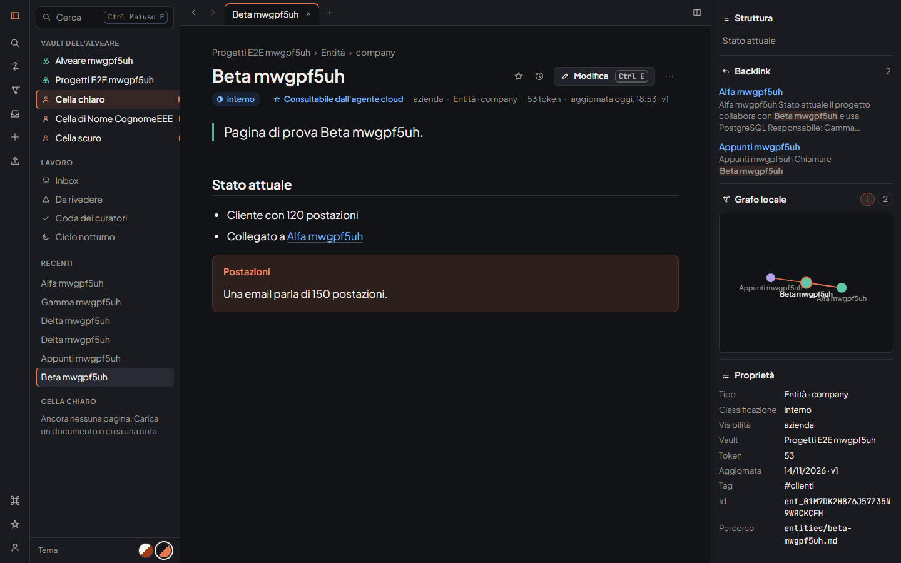
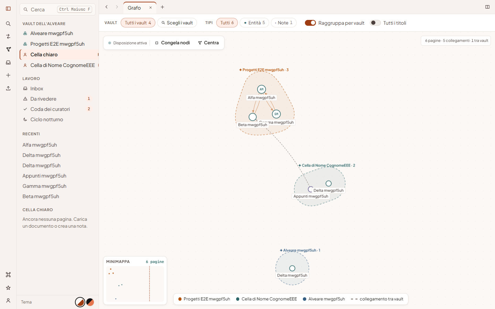
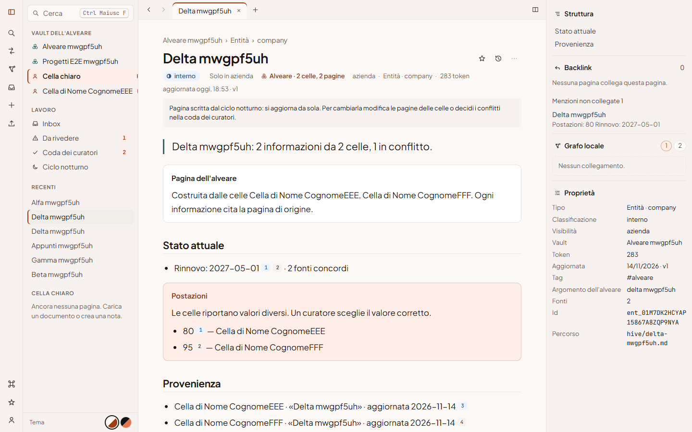
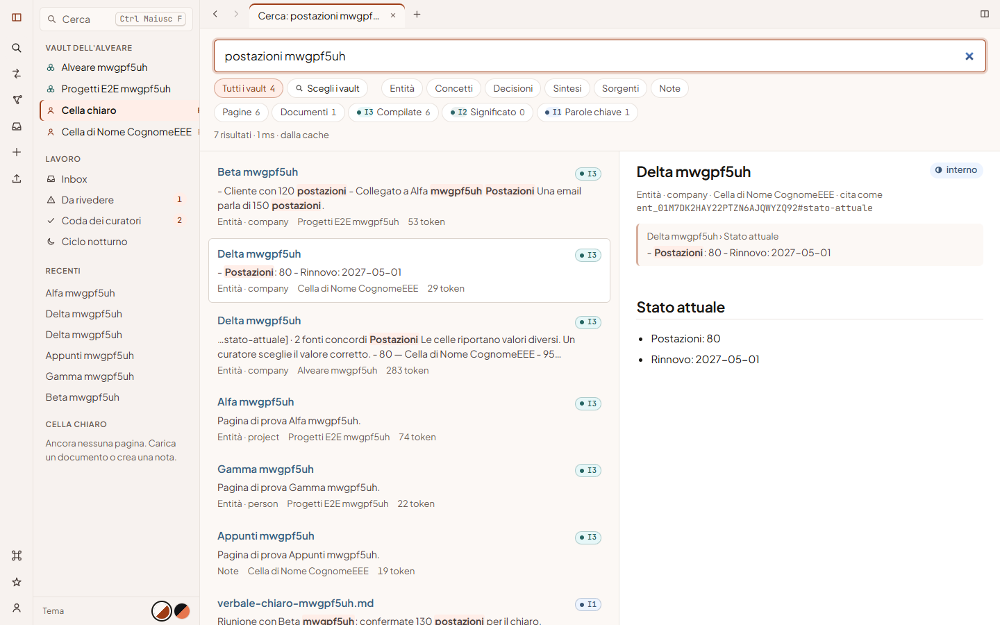
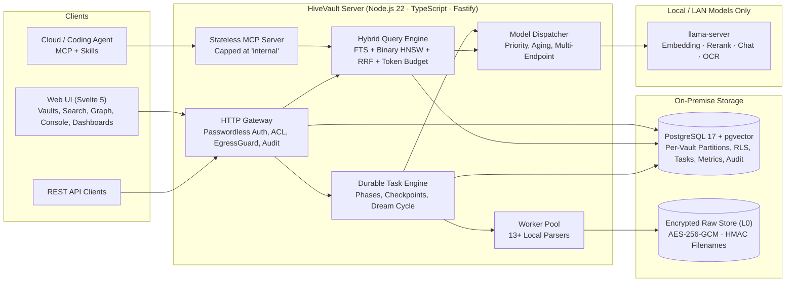

# HiveVault

### The Self-Hosted, Open-Source Second Brain for AI Agents and Companies

**Your documents never leave your server. Your AI agents stop forgetting. Your company stops losing what it knows.**

> [!WARNING]
> **Early Access — Not Yet Production Ready.**
> HiveVault is MIT-licensed open-source software under active development. While it already passes 190+ automated tests, OWASP ASVS L2 internal checks, and million-chunk benchmarks, **it still requires extensive real-world testing before production deployment**. Spin it up locally, try it with your AI agents, push its limits, and help us harden it.

---

## Why HiveVault Exists

Every modern team lives with two quiet, expensive problems:

1. **AI agents suffer from amnesia.** Every new chat or coding session starts from zero. Standard RAG pipelines dump raw, noisy, outdated document chunks into your context window — burning tokens, hallucinating stale facts, and forcing you to repeat yourself every single day.
2. **Companies suffer from institutional memory loss.** Critical knowledge stays scattered across personal notes, PDFs, spreadsheets, email threads, meeting minutes, and people's heads. When someone changes teams or leaves, years of context vanish. Yet handing raw company files to a cloud AI vendor is a security, privacy, and compliance non-starter.

**HiveVault bridges both worlds in one self-hosted system.**

It organizes knowledge as a **hive memory**: every person, team, edge device, and project gets an isolated **Cell** (vault), and shared **Hive Spaces** rise above them. Local models parse, index, and **compile** raw files into clean, interlinked, Obsidian-compatible Markdown pages — with a living *Current State*, a dated *Timeline*, and clickable citations back to the exact source passage. Every night, an automated **Dream Cycle** deduplicates entities, cross-links mentions, promotes verified knowledge from cells into the company Hive, and flags contradictions for human curators.

Meanwhile, your cloud AI agents connect over **MCP (Model Context Protocol)** — reading *only* compiled `public` and `internal` pages within strict token budgets, while original documents, `confidential`, `secret`, and `personal` vaults **never leave your server**.

---

<p align="center">
  
  
</p>

---

## Why Use HiveVault as a Second Brain for Your AI Agent?

Most "AI memory" tools are thin wrappers around a vector database. HiveVault is engineered from the ground up around **how LLM agents actually think, read, and fail**:

| Naive RAG / Vector Store | HiveVault (Compiled LLM-Wiki + MCP) |
|---|---|
| Returns raw, redundant fragments from outdated files | Returns **compiled truth** (`TL;DR` + *Current State*) separated from historical *Timeline* |
| Burns thousands of tokens dumping whole documents | **Token-budgeted reading**: every item reports its exact token cost and fits your `max_tokens` budget |
| Hallucinates or cites dead file paths | **Enforced stable citations** (`^[src#chunk]`): the compiler rejects uncited statements; ULIDs survive renames |
| Silent contradictions when two docs disagree | **Explicit conflict detection** (`[!conflict]`) surfaced to both agents and human curators |
| Blind keyword or noisy vector search | **Hybrid search (FTS + binary HNSW + rescoring + local reranking)** — **99.2% recall@5** on eval |
| Risky direct writes or read-only silos | Safe agent loop: `brain_capture` & `brain_journal` write to inbox; `brain_propose_edit` queues diffs for human approval |
| Leaks sensitive files if permissions slip | **Hard MCP ceiling at `internal`**, enforced before ranking + Postgres Row Level Security (**0% leakage** on canary tests) |

### Built-In Superpowers for Cloud & Coding Agents

- **11 Purpose-Built MCP Tools** over stateless Streamable HTTP (`POST /mcp`): `brain_overview`, `brain_search`, `brain_read`, `brain_neighbors`, `brain_timeline`, `brain_source`, `brain_ask`, `brain_capture`, `brain_journal`, `brain_propose_edit`, plus project-doc tools.
- **Progressive Disclosure That Saves Tokens:** Every page carries precomputed token counts, a `tldr`, and a concise *Current State* at the top. Your agent scans `brain_overview`, searches with `brain_search` (~840 tokens average response), and reads only what it needs — stopping early instead of flooding its context window.
- **Persistent Work Journal (`brain_journal`):** Start a session by reading yesterday's *Done / Decided / Open* notes, and close the session by logging what changed — automatically linked to real entities in your memory.
- **Dedicated Project Vaults for Coding Agents (`hivevault-progetti`):** Give your coding agent a live project vault per repository with six structured documentation sections (specifications, functional, technical, architectural, code index, documents), scoped to the developer's own permissions, with optimistic version checks and full audit trails.
- **Zero-Friction Plugin & Skills:** Ships with ready-to-install agent skills ([skills/README.md](skills/README.md)), a `.claude-plugin/` marketplace manifest, and `GET /llms.txt` discovery.

---

## Why Use HiveVault as a Second Brain for Your Company?

HiveVault is not just a developer toy — it is built to become **your organization's durable, sovereign collective memory**:

### 1. Collective Intelligence Without Losing Personal Privacy
- **Cell-to-Hive Architecture:** Every employee, team, project, and edge device works in its own vault (*Cell*). Private notes stay private — **personal vaults default to `personal` classification, invisible even to administrators** (enforced at the database level via PostgreSQL Row Level Security).
- **Automated Nightly Synthesis (The Dream Cycle):** While your team sleeps, a 12-step durable workflow updates stale parses, backfills embeddings, merges duplicate entities, auto-links unlinked `[[mentions]]`, promotes shared knowledge from Cells to Company Hive spaces, calculates page importance, refreshes `llms.txt` indexes, vacuums partitions, and verifies encrypted backups.
- **Contradictions Become Decisions, Not Confusion:** When Sales' cell says *"120 seats"* and Support's cell says *"150 seats"*, HiveVault does not silently pick one. It highlights the conflict on the Hive page and routes it to the **Curator Queue** so the right human makes the call — once, with full provenance.

### 2. True Data Sovereignty & Compliance by Design
- **Original Documents Never Leave Your Server:** PDFs, Word docs, Excel sheets, PowerPoints, emails (EML/MSG/MBOX), HTML, ZIPs, code, and scanned images (with optional local OCR) are parsed locally and stored encrypted with **AES-256-GCM** using per-vault keys and HMAC-obfuscated filenames.
- **100% Local AI Processing:** Embeddings, reranking, OCR, and wiki compilation run on your own hardware or LAN `llama-server` hosts — never on third-party APIs. An outbound **EgressGuard** blocks unauthorized network traffic at the socket level.
- **Enterprise-Grade Security:** Passwordless authentication (TOTP, WebAuthn passkeys, Ed25519/P-256/X.509 signature login, scoped API keys), **ACL before ranking** (partition pruning + Postgres RLS), append-only **SHA-256 hash-chained audit log**, **GDPR/privacy compliance checklists** ([docs/security/privacy.md](docs/security/privacy.md)), and an **OWASP ASVS 4.0.3 Level 2** security review ([docs/security/asvs-l2.md](docs/security/asvs-l2.md)).
- **Complete Transparency:** Every user sees a **"What the cloud agent read"** panel showing every MCP read of their cell's pages, and every page clearly displays whether cloud agents can consult it.

### 3. A Workspace People Actually Enjoy Opening
- **Obsidian-Inspired Editorial Web App (Svelte 5):** Fast tabs, split panes, `[[wikilink]]` autocomplete, hover previews, interactive WebGL/Canvas knowledge graph, side-by-side original document & extracted text viewer with highlighted citations, full version history with 1-click restore, and keyboard-first navigation (`Ctrl+K`, `Ctrl+O`, `Ctrl+Shift+F`).
- **Zero Lock-In, Forever:** 100% open source (MIT). Standard **PostgreSQL 17 + pgvector**. Export or import any vault as clean, Obsidian-compatible Markdown + ZIP at any time — with automatic restore points and mass-change safeguards.
- **Built-In Operations & Observability:** 11-section Admin Console, **10 Grafana-style built-in dashboards** (Overview, Ingestion, Search, Memory Health, Hive, Dream Cycle, Models, Database, Access & Security, Host), Prometheus `/metrics`, bulk folder importer for terabyte-scale file shares, and verified **pgBackRest** point-in-time recovery.

<p align="center">
  
  
</p>

---

## Proof, Not Promises: Verified Benchmarks

Every core engineering claim is backed by reproducible benchmarks in [`docs/spikes/`](docs/spikes/README.md):

| Benchmark | Measured Result | Details |
|---|---|---|
| **Hybrid search (1M chunks, 3 vaults)** | **30.5 ms p95** | Full `SearchEngine` with RLS, binary HNSW + rescoring, uncached ([report](docs/spikes/phase1-bench-long.md)) |
| **Hybrid search under load (40 users)** | **153 ms p95 · 0 errors** | 7,970 requests via k6, uncached searches ([Phase 8 report](docs/spikes/README.md#phase-8--hardening-and-release)) |
| **Token-budgeted page read** | **4.5 ms p95** (14 ms under 40-user load) | Progressive disclosure cut to `max_tokens` |
| **Retrieval accuracy (`brain_search`)** | **99.2% recall@5** | 131-question synthetic corpus, local reranking ([report](docs/spikes/phase6-eval-rerank20.md)) |
| **Confidential data leakage to MCP** | **0 / 10 canaries · 0 / 131 answers** | Even when the API account holds `secret` clearance |
| **Crash durability (task engine)** | **100% completed · 0 duplicates** | 300 tasks × 4 phases, 19 `SIGKILL` worker kills ([report](docs/spikes/spike-a.md)) |
| **Bulk import at scale** | **1,000,000 files · 0 errors** | 0 duplicates, 4.4 GB DB footprint, full I1 indexing ([report](docs/spikes/phase3-import-1000000.md)) |
| **Point-in-time backup restore** | **11 s restore** | Verified against 1.1M sources & vectors, identical row counts |
| **Accessibility & UI performance** | **Lighthouse 92–100 · WCAG 2.1 AA** | Checked with Playwright + axe across all themes |

---

## Try It in 3 Minutes (Local Demo)

Want to experience HiveVault right now — complete with pre-populated cells, a Hive space with live conflicts, a dark/light Obsidian-style UI, and an API key ready for your AI agent?

### Prerequisites
- **Node.js 22.19+**
- **Docker** (runs PostgreSQL 17 + pgvector)
- *(Optional)* `llama-server` + GGUF embedding/reranker models in `data/models/` (`LOCAL_MODELS_ENABLED=true`, `LOCAL_LLAMA_BIN`) — not required to explore the demo!

### 1. Clone, Configure & Start PostgreSQL

```bash
git clone <repository-url> hivevault
cd hivevault
npm install
cp .env.example .env
npm run db:up
npm run db:migrate
```

### 2. Seed the Demo Hive & Launch the App

```bash
npx tsx scripts/seed-demo.ts
npm start
```

In a second terminal, start the web app (Vite on port `5310`, proxied to API port `3700`):

```bash
npm run web:dev
```

### 3. Open the Workspace

1. Visit **`http://localhost:5310`**.
2. Sign in as **`demo`** using the 6-digit TOTP code printed by:
   ```bash
   npx tsx scripts/dev-totp.ts
   ```
3. Explore two personal cells feeding a shared **Customers** Hive space — inspect `[[wikilinks]]`, hover previews, the interactive knowledge graph, and resolve a live conflict in the **Curator Queue**.
4. Want to explore the **Admin Console** and **10 Grafana-style Dashboards**? Run:
   ```bash
   npx tsx scripts/dev-admin.ts
   ```
   It creates an `admin` account and prints its live TOTP code. *(You can also preview all UI themes at `http://localhost:5310/kitchen.html`.)*

### 4. Connect Your AI Agent via MCP

`scripts/seed-demo.ts` automatically creates an API key for `agent-demo` and saves it to `data/dev-demo.json`. Point any MCP-compatible client (Claude, Cursor, Codex, custom agent) at:

- **Transport:** Streamable HTTP
- **URL:** `http://localhost:3700/mcp`
- **Header:** `Authorization: Bearer <mcpKey>`

Or install the built-in agent plugin (MCP server + 3 skills) in plugin-capable agent clients — see [skills/README.md](skills/README.md):

```bash
export HIVEVAULT_URL=http://localhost:3700
export HIVEVAULT_API_KEY=<mcpKey>
```

```
/plugin marketplace add <git-url-or-local-path-of-this-repository>
/plugin install hivevault@hivevault
```

Now ask your agent: *"Call `brain_overview`, then tell me what we know about our customers and whether there are any open conflicts."* — Watch it navigate, cite, and respect token budgets effortlessly.

---

## Architecture at a Glance



Durable tasks, workflows, and the LLM-Wiki engine are implemented natively in TypeScript on top of PostgreSQL — **zero external agent-framework bloat, zero external queue services**.

---

## Deploying on a Server

Ready to evaluate HiveVault on a Linux server for your team or company? Follow the [Installation Guide](docs/guides/installation.md). Every role has a clear guide and checklist:

| Role | Guide | Checklist |
|---|---|---|
| Server installer & operator | [Installation](docs/guides/installation.md), [Operator](docs/guides/operator.md) | [Privacy §4.1](docs/security/privacy.md#41-who-installs-and-operates-the-server), [Release checklist](docs/RELEASE.md) |
| Adopting company (data controller) | [Privacy & Compliance](docs/security/privacy.md) | [Privacy §4.2](docs/security/privacy.md#42-company-adopting-the-software-controller) |
| HiveVault administrators | [Administrator](docs/guides/administrator.md) | [Privacy §4.3](docs/security/privacy.md#43-hivevault-administrators) |
| End users | [User](docs/guides/user.md) | [Privacy §4.5](docs/security/privacy.md#45-users) |

### Additional Documentation
- **Architecture & Development Plan:** [docs/DEVELOPMENT_PLAN.md](docs/DEVELOPMENT_PLAN.md)
- **Phase & Benchmark Reports:** [docs/spikes/README.md](docs/spikes/README.md)
- **Security Review (OWASP ASVS L2):** [docs/security/asvs-l2.md](docs/security/asvs-l2.md)
- **Agent Skills & Plugin:** [skills/README.md](skills/README.md)
- **Rules for Coding Agents Contributing Here:** [AGENTS.md](AGENTS.md)
- **Web App Screenshots:** [docs/ui/](docs/ui/)

---

## Development Setup & Commands

### First Administrator & HTTPS on LAN

Create a real administrator from scratch (instead of the demo seed):

```bash
npm run cb -- admin create <username> --name "First Last"
npm run cb -- enroll <activation-code>
npm start
```

Enable HTTPS on a LAN (required for WebAuthn passkeys outside `localhost`):

```bash
bash scripts/dev-ca.sh <host-or-IP>
```

Then set `TLS_CERT_FILE`, `TLS_KEY_FILE`, and `PUBLIC_URL` in `.env` and import `data/tls/ca.pem` as a trusted root CA on client devices.

In production, the server serves the compiled web bundle (`npm run web:build`, `WEB_DIR=packages/web/dist`) directly on its own port.

### Command Reference

| Command | Purpose |
|---|---|
| `bash scripts/deploy.sh [--install --host <name>] [--status] [--rollback]` | Install or update a remote server over SSH (`--target user@host` or `DEPLOY_TARGET` required): release folders, backup, migrations, health check with automatic rollback ([operator guide §4](docs/guides/operator.md#4-updates)) |
| `bash scripts/install.sh --host <name>` | Production install on Linux: `.env` with random secrets, build, database, backups, systemd service and timers ([installation guide](docs/guides/installation.md)) |
| `npm start` | Start the HTTP/MCP server |
| `npm run cb -- <command>` | CLI: `admin create`, `enroll`, `key gen`, `login --key`, `api create`, `audit verify`, `dream` |
| `npm run lint` | Type-check all Node packages |
| `npm run check -w @cb/web` | Type-check the Svelte 5 web app |
| `npm test` | Run unit and database tests (DB tests skip gracefully when Postgres is down) |
| `npm run e2e` | Run Playwright tests across themes with axe WCAG 2.1 AA checks (uses Edge by default; `E2E_CHANNEL=chrome` for Chrome) |
| `npm run web:build` | Build the web app into `packages/web/dist` |
| `npx tsx scripts/seed-demo.ts` | Seed demo data for development (`demo` user, two cells feeding a shared Hive space, `agent-demo` MCP key) |
| `npx tsx scripts/dev-admin.ts` | Create development `admin` account for console and dashboards and print its TOTP code |
| `npx tsx scripts/dream-now.ts <vault-slug>` | Trigger a vault's Dream Cycle immediately through the running server (development) |
| `npm run backup -- full\|diff\|info\|check\|verify` | Manage encrypted pgBackRest backups; `verify` runs an automated point-in-time restore test in a temporary container |
| `npx tsx bench/phase6/eval.ts --ask 30` | Run retrieval evaluation with real local models (stop the server first) |
| `npx tsx bench/phase8/load-seed.ts` + `bench/phase8/load.js` | Run k6 load tests (official Docker image) |
| `npx tsx bench/phase7/metrics-bench.ts --days 7` | Benchmark 7 days of 1-minute metrics, rollups, and all 10 dashboards |
| `npm run corpus -- --seed 42 --out data/corpus/dev` | Generate deterministic synthetic corpus with facts, contradictions, and evaluation questions |
| `npm run spike:a -- 300 3 700` | Crash-test the durable task engine with real process kills |
| `npm run spike:c -- --checkpoints 1000000,2000000,5000000` | Benchmark PostgreSQL + pgvector at multi-million chunk scale |
| `npm run spike:d -- --bin <llama-server> --model <model.gguf>` | Benchmark CPU embeddings across local and remote endpoints |
| `npm run bench:phase1 -- --chunks 1000000` | Benchmark the full query engine on 1M chunks |
| `npx tsx bench/corpus/formats.ts --per 20` | Generate test corpus: 20 files for each of 13 formats |
| `npx tsx bench/phase3/crash.ts 60 2 1500` | Crash-test ingestion and compilation under worker kills |
| `npx tsx bench/phase3/import.ts 1000000 2 60 --ingest-wait` | Benchmark bulk import of N synthetic files |
| `npm run spike:c2 -- --target paradedb` | Compare `tsvector` vs ParadeDB BM25 (`docker compose --profile spikes up -d paradedb`) |

---

## Contributing & Help Us Test

Because HiveVault is in active pre-production development, **every bug report, edge-case document, benchmark run, security review, and pull request makes a direct difference**.

- Try uploading your trickiest PDFs, spreadsheets, or email archives locally and report parser edge cases.
- Connect your favorite MCP coding or research agent and tell us where token budgets or retrieval can be sharper.
- Read [AGENTS.md](AGENTS.md) before making architectural changes so all 20 system invariants stay intact.

---

## License and Disclaimer

**MIT License** — see [LICENSE](LICENSE).

The software is provided "as is", without warranty of any kind, and the authors are not liable for its use. The authors do not operate any installation and receive no data: the organization that installs and uses the software is solely responsible for its operation and for compliance with data protection law. The documents in `docs/` are not legal advice. Full details in [DISCLAIMER.md](DISCLAIMER.md).

HiveVault is not affiliated with any product or trademark with a similar name. Obsidian, Qwen, llama.cpp, and other names cited are trademarks of their respective owners; this project is not affiliated with them.
