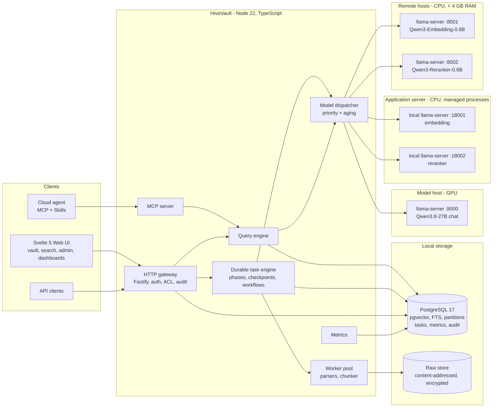

# HiveVault — Development Plan

> Version 0.4 · 2026-10-27 · Status: **draft for approval**
> Standalone TypeScript implementation, **inspired** by Karpathy's LLM-Wiki pattern. Durable tasks, workflows, and the wiki are our own implementations.

**Changes since v0.1**

| Topic | Decision |
|---|---|
| D1 Cloud agent and compiled text | Accepted: the cloud agent reads `pubblico` (public) / `interno` (internal) pages according to clearance; **the user is notified** (§3.6). |
| D2 Workflows | Closed by the decision above: our own workflow DSL built on top of the task engine. |
| D3 Frontend | Svelte 5 + Vite. |
| D4 Models | Local, on a model host reachable over the network (`<model-host>:8000`) (§2.4). |
| D5 Scale | Multiple **TB** of documents → **PostgreSQL + pgvector from day one** (§3, §6). |
| D6 OTP | TOTP only. |
| D7 Embedding/reranker (v0.3) | No free VRAM on the 27B host → small models (< 4 GB RAM total) on a **separate host**, running on CPU (§2.4). |
| D8 Hardware (v0.3) | Development server: 64 GB RAM, 100 GB free disk → scaled-down dev datasets and spikes; production sizing by formula (§2.5). |
| D9 Sample corpus (v0.3) | No real sample available: generic estimates, synthetic corpus + public corpora; the system measures actual ratios in production (§0.1, §10). |
| D10 Where embedding/reranker run (v0.4) | Both modes, even simultaneously: local `llama-server` processes managed by the server (CPU, capped threads) + remote endpoints; the dispatcher verifies that the model is identical everywhere (§2.4). |

---

## 0. Summary

**HiveVault** is a self-hosted server that maintains a company's memory as a **hive memory**:

- each **cell** (person, edge, team, project) has its own isolated, indexed **vault**;
- above the cells sits the **hive**: collective pages produced by promoting, merging, and reconciling knowledge from cells, with provenance preserved;
- knowledge is **compiled** (LLM-Wiki): documents update entity, concept, decision, and timeline pages connected by `[[link]]` references, and the nightly cycle optimizes them;
- the format is **designed for the cloud agent**: hierarchical index, multi-level summaries, token count per result, stable citations, MCP server, and Skills;
- **original documents never leave the server**: parsing, embedding, compilation, and the nightly cycle use only models on the LAN.

### 0.1 What changes with "multiple TB"

**Generic** orders of magnitude (no real sample exists, D9): these are design assumptions. In production, the "Ingestion" dashboard measures the actual ratios (text/volume, tokens/GB, chunks/document) and recalculates storage and time estimates.

| Metric | Estimate per 1 TB of mixed documents |
|---|---|
| Extractable text | 3–10% of volume → 30–100 GB of text |
| Tokens | ~8–25 billion |
| ~500-token chunks | **15–50 million** per TB |
| 1024-dim `halfvec` vectors | 2 KB/chunk → 30–100 GB per TB (plus the HNSW index) |

Consequences that drive the entire plan:

1. **Not everything can go through the LLM.** With a single `llama-server`, a 27B model, and one request at a time (`-np 1`), compiling every document with the LLM would take years. Therefore ingestion is **tiered** (§4.1): *all* documents are parsed, indexed, and made searchable (no LLM required); compilation into the wiki runs **selectively and progressively**, starting with what matters most (user uploads, recent documents, frequently cited or searched entities) and, on demand, whenever a search hits documents not yet compiled.
2. **Embeddings are also a bottleneck, and they run on CPU (D7).** A 0.6B model on CPU produces roughly 1–4k tokens/s per host (to be measured in Spike D): the full archive would take **months**. Therefore embeddings follow the same priority model as compilation: user uploads, recent documents, and most-queried spaces first; the rest progresses in the background. **BM25 search is available across everything immediately**; semantic coverage grows over time and is clearly visible. Load can be distributed by adding embedding instances on additional machines (the dispatcher uses them in parallel).
3. **Mandatory partitioning.** Tables are partitioned by vault/space: a search touches only the allowed partitions (isolation + performance).
4. **Bulk import.** Multiple TB cannot be uploaded through a browser: an admin-managed **importer from local folders/shares** (mounted SMB/NFS, mail archives) is required (§4.4).

### 0.2 Performance targets (to be confirmed in Spike C)

| Operation | p95 target | Conditions |
|---|---|---|
| Hybrid search, allowed spaces ≤ 5M chunks | < 200 ms | without rerank |
| Hybrid search across the entire hive (50M chunks) | < 600 ms | HNSW + partition pruning |
| Local rerank top 20 (CPU) | +0.3–1 s | optional, to be measured in Spike D |
| Page read with token budget | < 20 ms | — |
| Level-1 ingestion (parse + chunk + BM25) | ≥ 50 pages/s per worker | without GPU |
| Embedding | bounded by embedding host CPU, tracked in dashboard | batch 32, multiple instances in parallel |
| Nightly cycle | configurable window (default 01:00–06:00) | resumes the next night |

---

## 1. Requirements analysis

### 1.1 Functional requirements

| ID | Requirement | Analysis notes |
|---|---|---|
| F1 | Admin creates and manages (CRUD) user accounts and API accounts | API accounts = non-human identities with scopes, allowed vaults, clearance, and expiration. |
| F2 | Login via **TOTP**, **passkey**, or **challenge** | TOTP = RFC 6238 (authenticator app); passkey = WebAuthn; challenge = **signature** of `{server origin, username, nonce, ts}` using the user's private key or certificate (Ed25519 / ECDSA P-256 / X.509). The "username encrypted by the key" requirement is implemented as a signature: it proves key possession, the single-use nonce prevents replay, and the origin prevents another server from forwarding the signature. |
| F3 | Full system CRUD for administrators | Users, API accounts, cells, spaces, permissions, sources, pages, jobs, imports, models, settings, and audit log. |
| F4 | Grafana-style thematic dashboards | Panel grid, time range, auto-refresh, variables, drill-down; Prometheus `/metrics`. |
| F5 | UI themes | `notte`, `carta`, `ufficio`, `colorato` (§9.1). |
| F6 | Users browse and search their own memory | Obsidian-style navigation. |
| F7 | Users browse and search permitted company memory | ACL applied *before* querying (partition pruning + RLS). |
| F8 | Upload of pdf, word, excel, pptx, images, eml/msg/mbox, csv, md, txt, links | Local parsers; the original file stays on the server. |
| F9 | Deferred ingestion | Durable priority queue, visible per-document status. |
| F10 | Nightly optimization | "Dream" cycle (§5). |
| F11 | Obsidian-like navigation with Markdown and links | `[[wikilink]]`, backlinks, hover preview, graph, quick switcher, tabs, and split panes. |
| F12 | Optimal consultation by the cloud agent | MCP, Skills, `llms.txt`, token budgets. |

### 1.2 Non-functional requirements

| ID | Requirement | Design choice |
|---|---|---|
| N1 | Documents always stay local | Encrypted raw store on local disk; parsers and models on the LAN; outbound network egress guard with a model-host allowlist; raw files are never exposed over MCP. |
| N2 | TB-scale performance | PostgreSQL 17 + pgvector, partitioning, HNSW on `halfvec`, GIN-indexed FTS, connection pooling, version-keyed caching (§6). |
| N3 | Durability | Our own task engine on Postgres: phases, checkpoints, idempotency, crash recovery (§2.2). |
| N4 | Isolation | Per-vault partitions + Row Level Security as a second line of defense + dedicated isolation tests. |
| N5 | Audit | Every API/MCP read and every write/mutation is logged. |
| N6 | Professional UI | Unified design system, keyboard-first, WCAG 2.1 AA. |
| N7 | Language | Italian UI; IT/EN content → multilingual embeddings and `italian`/`english` FTS. |
| N8 | Backup | `pgBackRest` (full + WAL, point-in-time recovery) + raw store snapshots. |

### 1.3 Critical points

1. **Single-model capacity.** See §0.1: selective compilation, priority dispatcher, BM25 available immediately.
2. **The model server is currently powered off.** Development uses a **mock provider** (recorded responses) and a real OpenAI-compatible provider behind the same interface. Quality tests with the real model run once the host is powered on.
3. **Embedding and reranker do not exist on the existing setup** and the 27B host has no free VRAM. Two small `llama-server` instances run on CPU on a separate host (§2.4).
4. **Invariant:** no files, models, or configurations are modified on the model host; HiveVault only calls its HTTP endpoints.

---

## 2. Architecture



### 2.1 Stack

| Layer | Choice | Rationale |
|---|---|---|
| Runtime | Node.js 22+, TypeScript strict, ESM | — |
| HTTP | **Fastify** | 2–3× Express throughput, JSON Schema validation and serialization. |
| Database | **PostgreSQL 17 + pgvector ≥ 0.8** | TB scale, `halfvec`, HNSW with iterative index scans (filters + vectors), built-in FTS, partitioning, RLS, `SKIP LOCKED` for queues, `LISTEN/NOTIFY`. |
| DB access | `postgres` (porsager) + explicit SQL, migrations via an internal runner (numbered SQL files, checksums, advisory lock) | Hand-tunable queries; no ORM sitting between us and the indexes. |
| Pooler | `pgbouncer` (transaction mode) | Thousands of short requests without exhausting connections. |
| Raw store | Local content-addressed filesystem: the address is the content `sha256` (database and `BlobStore` interface), and the on-disk filename is `k/ab/cd/<HMAC-SHA256(vault filename key, sha256)>`. Files named with the legacy scheme (`ab/cd/<sha256>`) are renamed on the first server startup: this migration is irreversible, and older versions cannot read the new filenames | Simple and fast; without the key, a copy of the files does not reveal which known documents it contains; a local S3-compatible implementation (e.g., Garage/SeaweedFS) can be added behind the same interface if multiple nodes are needed. |
| Models | OpenAI-compatible `llama-server` (§2.4) | — |
| Frontend | **Svelte 5 + Vite + TypeScript** | Decided (D3). |
| Editor | **CodeMirror 6** with live preview | Like Obsidian. |
| Markdown | `markdown-it` + plugins for wikilinks, callouts, tables, Mermaid, KaTeX; server-side rendering cached by content hash | — |
| Graph | **sigma.js + graphology** (WebGL) | Tens of thousands of nodes. |
| Charts | **uPlot** (time series) + ECharts for heatmaps/Sankey | — |
| Auth | `@simplewebauthn/server`, `otplib`, `node:crypto` | No external auth services. |
| Deployment | Docker Compose: `postgres` (pgvector image), `pgbouncer`, `app`, `parser-sidecar` (optional) | Repeatable Linux installation; development also supported on Windows. |

### 2.2 Core concepts, built in-house

The project does not depend on external agent frameworks. It implements these concepts directly:

| Inspiration | Concept | Implementation in HiveVault |
|---|---|---|
| **Durable tasks** | Task = state machine with per-phase checkpoints; tool intent recorded before execution; `replaySafe` tools; idempotent `requestId`; durable `sleepUntil`; child tasks; per-conversation usage | `packages/tasks`: `tasks` table (status, phase, JSONB checkpoint, `run_after`, attempts, owner), `task_events` (append-only journal). Workers claim tasks with `FOR UPDATE SKIP LOCKED`, woken via `LISTEN/NOTIFY`. On restart: an interrupted phase resumes from its checkpoint; an interrupted non-`replaySafe` tool is flagged instead of blindly retried. |
| **Extensible workflows** | `parallel()`, `pipeline()`, `checkpoint()` (human approval), deterministic resumable workflows | `packages/workflows`: thin TypeScript functions built over the task engine. `parallel` spawns child tasks and waits; `pipeline` chains phases; `checkpoint` creates an approval queue item and suspends the task. Used by ingestion and the dream cycle. |
| **LLM-Wiki** | `SCHEMA.md`, `index.md`, `log.md`, `entities/concepts/summaries` folders, frontmatter, ingest/query/lint | Page data model (§3), ingest/query/lint operations as workflows, Obsidian-compatible export. |
| **pi-memory** | Durable facts and preferences | `claims` table (atomic statements with source) and quick notes in `_inbox`. |

### 2.3 Repository layout (npm workspaces)

```
hivevault/
├── AGENTS.md / CLAUDE.md          # rules for coding agents working on this repo
├── docker-compose.yml
├── packages/
│   ├── shared/      # types, frontmatter schema, ULID, token counting, errors
│   ├── db/          # migrations, partitions, RLS, SQL repositories
│   ├── blobs/       # BlobStore (filesystem, AES-256-GCM encryption)
│   ├── tasks/       # durable task engine
│   ├── workflows/   # parallel / pipeline / checkpoint
│   ├── models/      # priority + aging dispatcher, llama-server provider, mock provider
│   ├── parsers/     # one parser per format + worker pool + optional sidecar
│   ├── brain/       # chunking, embedding, wiki compilation, graph, query, budget
│   ├── jobs/        # ingestion, bulk import, dream cycle, maintenance
│   ├── auth/        # TOTP, passkey, challenge, sessions, API keys, RBAC/ACL, audit
│   ├── metrics/     # collection, rollups, queries, Prometheus export
│   ├── mcp/         # MCP server
│   ├── server/      # Fastify: REST, SSE, static assets
│   └── web/         # Svelte 5 SPA
├── skills/          # Skills for the cloud agent
├── .claude-plugin/  # plugin for the cloud agent
├── bench/           # synthetic datasets and benchmarks
├── eval/            # retrieval quality question set
└── docs/
```

### 2.4 Local models

```env
# Chat / compilation
LLAMA_SERVER_URL=http://<model-host>:8000
LLAMA_MODEL_ID=<model-path>.gguf
LLAMA_PARALLELISM=1
LLAMA_MAX_TOKENS=16384
LLAMA_CONTEXT_TOKENS=            # empty = read from GET /props
LLAMA_TEMPERATURE=0.2
LLAMA_REQUEST_TIMEOUT_MS=1200000
LLAMA_IDLE_TIMEOUT_MS=180000
LLAMA_AGING_MS=600000            # a waiting request gains priority every 10 min

# New: CPU embedding and reranker (D7), local and/or remote (D10)
EMBED_MODEL_ID=Qwen3-Embedding-0.6B-Q8_0.gguf   # ~0.65 GB, multilingual (IT/EN), Matryoshka
EMBED_DIMENSIONS=1024                           # truncation to 512 evaluated in Spike C
RERANK_MODEL_ID=Qwen3-Reranker-0.6B-Q8_0.gguf   # ~0.65 GB

# Local: the server starts and supervises its own llama-server processes
LOCAL_MODELS_ENABLED=true
LOCAL_LLAMA_BIN=/opt/llama.cpp/llama-server     # llama.cpp binary installed by admin
LOCAL_MODELS_DIR=data/models                    # .gguf files copied by admin
LOCAL_EMBED_PORT=18001                          # 127.0.0.1 only
LOCAL_RERANK_PORT=18002
LOCAL_MODELS_THREADS=8                          # core cap: leaves CPU for Postgres and parsers
LOCAL_MODELS_SCHEDULE=always                    # always | off-hours (e.g. 19:00-07:00) | on-demand

# Remote: zero or more instances on other machines (comma-separated list)
REMOTE_EMBED_URLS=http://<host-a>:8001,http://<host-b>:8001
REMOTE_RERANK_URLS=http://<host-a>:8002

MODELS_OFFLINE_MODE=mock                        # mock | queue: behavior when an endpoint is offline
```

**Two modes, optionally active at the same time (D10):**

| | Local (application server) | Remote (other machines) |
|---|---|---|
| Startup | The server launches `llama-server` as a child process (`packages/models/local-supervisor`) | Admin starts `llama-server` on the remote host with the commands below |
| Network | `127.0.0.1` only | LAN; IPs allowlisted in the network egress guard; optional token (`--api-key`) |
| Lifecycle | Supervisor: health check every 10 s, backoff restart, logs in the "Models" dashboard, clean shutdown with the server | Health checks only; unreachable endpoints are excluded and retried |
| Resources | Capped `--threads` and low process priority (`nice`/`BELOW_NORMAL`), keeping search and Postgres responsive; configurable schedule (`off-hours`) to run at full speed overnight | Full host resources |
| Admin UI management | Start/stop, threads, schedule, active model, RAM, and tokens/s | Add/remove endpoints, test `/health`, tokens/s, latency |
| Typical use | Development; small installations; always ready for interactive queries | Throughput for embedding backfill: every additional machine adds capacity |

**Dispatcher rules for mixed endpoints:**
- **Same model everywhere.** Vectors from different models are incomparable. On startup and on every reconnect, the dispatcher queries `GET /props` (or `/v1/models`) on each endpoint and checks the model name, quantization, and vector dimension against `EMBED_MODEL_ID`/`EMBED_DIMENSIONS`; a mismatched endpoint is rejected with a dashboard error. Every stored vector records its model ID (`embedding_model`), so a future model change becomes a controlled migration rather than silent corruption.
- **Priority-based routing.** Interactive queries (`p0`, a single text to embed) go to the lowest-latency endpoint, usually the local one. Ingestion and backfill batches (`p1`/`p2`) are spread across all endpoints in proportion to measured throughput (tokens/s).
- **Fallback.** If all remote endpoints are offline, the local endpoint handles everything; if the local endpoint is also offline, `MODELS_OFFLINE_MODE` applies.

**RAM budget per instance (D7: < 4 GB, applies to local and to each remote host):**

| Instance | Model (Q8_0) | Context / batch | Estimated RAM |
|---|---|---|---|
| Embedding | ~0.65 GB | `-c 8192 -b 2048 -ub 2048`, 4 slots | ~1.2 GB |
| Reranker | ~0.65 GB | `-c 4096`, 2 slots | ~1.0 GB |
| **Total** | | | **~2.2 GB** (headroom under 4 GB) |

Commands for a remote host (the local supervisor uses the same arguments with `--host 127.0.0.1` and local ports):

```bash
llama-server -m Qwen3-Embedding-0.6B-Q8_0.gguf --embedding --pooling last -c 8192 -np 4 --host 0.0.0.0 --port 8001 --api-key <token>
llama-server -m Qwen3-Reranker-0.6B-Q8_0.gguf --reranking -c 4096 -np 2 --host 0.0.0.0 --port 8002 --api-key <token>
```

For remote hosts, the repository includes `scripts/embed-host/`: a systemd unit (Linux) and a Windows service running the commands above, plus a check verifying the model matches the server.

- Alternatives if CPU quality or speed is insufficient: `bge-m3` (~0.6 GB in Q8, strong in Italian) for embeddings; `bge-reranker-v2-m3` for reranking. Spike D benchmarks both.
- On the development server (64 GB), local mode runs by default; remote-mode tests use a second instance on another port or another LAN machine.
- Reranking is **optional per query** (`rerank: true`), because on CPU it adds 0.5–2 s on the top 50: it is used for `brain_ask` and searches where precision outweighs latency; by default it reranks the top 20.
- **Dispatcher**: one queue per endpoint, parallelism 1 on the chat model, priority `p0` interactive (search, `brain_ask`) > `p1` ingestion > `p2` dream, with aging.
- **Offline host**: `mock` in development (recorded responses, deterministic hash-based embeddings); `queue` in production: tasks requiring the model wait and resume automatically once `/health` responds. BM25 search continues working uninterrupted.
- The dispatcher manages **multiple endpoints per kind**: chat (1 endpoint, parallelism 1), embedding (N endpoints, weighted round-robin based on measured latency), rerank (1+). An endpoint failing `/health` is excluded and periodically retried.

### 2.5 Sizing (D8)

**Development server: 64 GB RAM, 100 GB free disk.** Development disk budget:

| Item | Space |
|---|---|
| Postgres: development dataset (~500k chunks, public + synthetic corpora) | ~5 GB |
| Postgres: Spike C dataset (5M chunks, deleted afterward) | ~35 GB |
| Development raw store | ~10 GB |
| Embedding/reranker models (if hosted here) | ~1.5 GB |
| Backups, WAL, headroom | ~25 GB |
| **Total** | **~75 GB out of 100** |

Postgres settings in development: `shared_buffers=12GB`, `effective_cache_size=40GB`, `maintenance_work_mem=4GB` (HNSW builds), `work_mem=64MB`.

**Production: formula per TB of documents** (generic assumptions §0.1, recalculated by the dashboard from real data):

| Component | Per TB of documents | Notes |
|---|---|---|
| Raw store | ~1 TB (minus deduplication, typically 10–30% on emails and attachments) | High-capacity disks, HDD acceptable |
| Chunk text + `tsvector` + GIN | 60–200 GB | SSD/NVMe |
| `halfvec(1024)` vectors | 30–100 GB | 15–50 GB with 512 dimensions |
| HNSW index | ~1–1.5× vector size | Must fit **in RAM** for performance |
| Wiki pages, links, claims, metadata | < 5 GB | — |
| **Total DB** | **~150–450 GB per TB** | NVMe |
| Recommended RAM | 64 GB up to ~10M chunks; 128–256 GB beyond, **or** `pgvectorscale` (StreamingDiskANN, on-disk index) or binary vectors with rescoring | Decision after Spike C |

The project does not assume fixed production hardware: thresholds are configurable parameters, and the "Database" dashboard alerts when the vector index no longer fits in cache.

---

## 3. The memory model

### 3.1 Layers

| Layer | Contents | Written by | Mutable |
|---|---|---|---|
| **L0 Raw** | Original file, content-addressed by SHA-256, encrypted (per-vault key) | Upload / import | No |
| **L1 Extracted** | Normalized Markdown text + metadata + chunks + embeddings | Parser + chunker | Regenerated when the parser changes |
| **L2 Cell wiki** | Compiled pages: entities, concepts, decisions, summaries, syntheses | Local LLM + user | Yes, versioned |
| **L3 Hive** | Collective pages per company space | Dream cycle + curators | Yes, versioned with provenance |
| **Schema** | `SCHEMA.md` per vault: types, conventions, compilation rules | Admin / curators | Yes |

### 3.2 Cells and hive

- **Cell** = vault owned by `user:<id>`, `edge:<id>`, `team:<id>`, or `project:<id>`.
- **Hive** = shared spaces (`hive:clients`, `hive:projects`, `hive:technical`…) with `read` / `write` / `curate` / `admin` ACLs.
- **Promotion** cell → hive during the dream cycle: agreeing claims from multiple cells are merged (with source count); contradictions produce a `> [!conflict]` block and an item in the curator queue; every statement carries its provenance `^[cell:page#block]`; retracting information in a cell propagates upward.
- **Visibility**: `privato` (private) · `team` · `azienda` (company). **Classification**: `pubblico` (public) · `interno` (internal) · `riservato` (confidential) · `segreto` (secret).

### 3.3 Source of truth and Obsidian compatibility

At TB scale, the **source of truth is Postgres** (pages, versions, links). The format remains compatible with Obsidian:

- export of a vault as a folder with `SCHEMA.md`, `index.md`, `log.md`, `llms.txt`, `wiki/{entities,concepts,decisions,sources,syntheses,_inbox}/*.md`;
- import of an existing Obsidian vault (Markdown + `[[link]]`);
- optional two-way sync for small vaults (personal cell).

### 3.4 Page format optimized for the cloud agent

```markdown
---
id: ent_01JB8K3...            # stable ULID: links survive title renames
title: Acme S.p.A.
type: entity/company
aliases: [Acme, ACME spa]
tldr: Fintech client since 2024; 500-seat SaaS contract; technical contact Name SurnameAAA.
tags: [client, fintech]
visibility: azienda
classification: interno
sources: [src_7f3a..., src_91bc...]
confidence: 0.86
updated: 2026-10-26
tokens: 742
---

# Acme S.p.A.

## Current status            ← "compiled truth", rewritten on every update
- 500-seat SaaS contract, renewal 2027-03 ^[src_7f3a#c12]
- Technical contact: [[Name SurnameAAA]] ^[src_91bc#c3]

## Open issues
- [ ] Security review of the new plan (due 2026-11-01) ^[src_91bc#c7]

## Timeline                  ← append-only, dated evidence
- 2026-10-22 · Pricing call with [[Name SurnameAAA]] ^[src_91bc]
- 2026-04-10 · Contract signed ^[src_7f3a]

## See also
[[Project Atlas]] · [[Enterprise Plan]]
```

- `tldr` and "Current status" (`Stato attuale`) at the top: progressive disclosure so the cloud agent can stop early.
- Precomputed `tokens`: the server trims to budget without recounting.
- Stable `^[src#chunk]` citations resolvable via `brain_source`. Any compiled statement without a source is rejected.
- "Current status" + "Timeline": the always-read section stays short while evidence accumulates below.
- Addressable blocks (`#^blockid`): partial reads and citations, per-block visibility.

### 3.5 PostgreSQL schema (essential)

All large tables are **partitioned by `vault_id`** (`PARTITION BY LIST`, one partition per large vault, `HASH` partitions for small cells). Every query includes `vault_id = ANY($allowed)` → partition pruning.

| Table | Contents | Indexes |
|---|---|---|
| `vaults` | id, type (cell/space), owner, schema_md, version | — |
| `pages` | id, vault_id, title, type, tldr, body_md, visibility, classification, tokens, hash, importance, updated_at | btree (vault, type, updated), trigram on title |
| `page_versions` | history (diff) | (page_id, version) |
| `aliases` | vault_id, normalized alias → page_id | unique → O(1) `[[link]]` resolution |
| `blocks` | page_id, block_id, heading_path, offset, tokens | section-level reading |
| `sources` | sha256, vault_id, mime, name, size, pipeline status, level reached, parser_version, priority | (status, priority) |
| `chunks` | id, vault_id, source_id \| page_id, text, tokens, lang, hash, `tsv tsvector` (generated: `italian` or `english` by language + `simple` for codes and names), `embedding halfvec(1024)` | **GIN** on `tsv`; **HNSW** `halfvec_cosine_ops` per partition (m=16, ef_construction=64); btree on hash |
| `links` | src_page, dst_page, dst_unresolved, kind (wikilink, mention, `works_at`, `owns`, `decided_by`…) | both directions |
| `claims` | subject, predicate, object, source, date, confidence, status | per entity; basis for merges and contradiction detection |
| `tasks`, `task_events` | task engine (§2.2) | partial (status, run_after, priority) on active tasks |
| `metrics_*` | daily-partitioned time series + rollups | BRIN on timestamp |
| `audit_log` | monthly-partitioned | BRIN on timestamp |

**Row Level Security** on `pages`, `chunks`, `sources`: the session sets `app.principal` and `app.clearance`; policies enforce vault and classification filtering. Application-level filtering remains the first line of defense; RLS is the second, protecting against bugs.

To be evaluated in Spike C: **ParadeDB `pg_search`** (true BM25, faster than `ts_rank` at scale) and **`pgvectorscale`** (StreamingDiskANN, on-disk index for tens of millions of vectors with low RAM).

### 3.6 Egress to the cloud agent and user notice (D1)

| Classification | Internal UI | Local models | Cloud agent via MCP |
|---|---|---|---|
| `pubblico` (public) | ✔ | ✔ | ✔ |
| `interno` (internal) | ✔ | ✔ | ✔ if API account has `clearance ≥ interno` |
| `riservato` (confidential) | ✔ (ACL) | ✔ | ✖ |
| `segreto` (secret) | ✔ (ACL) | ✔ | ✖ always |

**User notice:**
- on first login: disclosure explaining that compiled text of `pubblico`/`interno` pages can be read by the cloud agent (an external service) via authorized API accounts, whereas original documents never leave the server; the user acknowledges the notice (recorded in the audit log);
- on every page: "Readable by cloud agent" badge whenever the page is readable by at least one MCP account;
- on upload: the proposed classification is displayed with the same notice and can be raised before compilation;
- for admins: creating an API account with `interno` clearance shows the same notice;
- in the personal cell: "What the cloud agent read" panel listing MCP reads of the user's own pages (from the audit log).

Filtering is applied in the query engine **before** ranking and enforced again by RLS.

---

## 4. Ingestion

### 4.1 Processing tiers (the key to TB scale)

| Tier | Steps | Cost | Who reaches it |
|---|---|---|---|
| **I1 Indexed** | detect → parse → chunk → FTS | CPU only | **all** documents |
| **I2 Semantic** | chunk embedding | embedding host CPU | all, in priority order |
| **I3 Compiled** | source summary, updating entity/concept/decision pages, claims, links | 27B LLM (`-np 1`) | selected by priority and on demand |

**Compilation priority (I3):** direct user uploads > documents cited by existing pages > recent documents > documents for the most-searched entities > everything else. **On-demand compilation:** when a search returns chunks from documents that are only at I1/I2, those documents move up the queue; the dashboard shows per-space coverage (`% I1/I2/I3`).

### 4.2 Flow (durable task `ingest`, requestId = `sha256:vault`)

```
upload / import ─▶ BlobStore (sha256, encrypted, dedup) ─▶ immediate 202
  [1] detect   true MIME (magic bytes), language, size
  [2] parse    worker pool / sidecar → L1 markdown + metadata + attachments (recursive)
  [3] chunk    by structure (headings, slides, sheets, email threads), 300–800 tokens, 10% overlap
  [4] index    COPY into chunks + tsv                               → I1: immediately searchable (BM25)
  [5] embed    batches of 64, dedup by hash, priority p1            → I2
  [6] compile  LLM workflow (only if selected) using vault tools:
               reads SCHEMA.md and entity index, writes sources/<doc>, updates 5–15 pages,
               extracts claims, adds links, writes log              → I3
  [7] classify proposed classification and visibility (rules + LLM)
  [8] notify   SSE to user, log, metrics
```

Every step is a checkpointed phase. Read-only tools are `replaySafe`; write tools are idempotent (keyed by id + hash).

### 4.3 Parsers (all local)

| Format | Parser | Notes |
|---|---|---|
| PDF | `pdfjs-dist` → **docling** sidecar for complex tables and layouts | Scans → OCR |
| DOCX | `mammoth` | Headings, lists, tables |
| XLSX / CSV | `exceljs` (streaming) / `papaparse` | Small sheets → Markdown table; large sheets → schema + per-column stats + sample rows; data queryable as a temporary table |
| PPTX | XML via `jszip`: title, text, speaker notes per slide | One section per slide |
| EML / MSG / MBOX / PST | `mailparser`, `@kenjiuno/msgreader`; PST via sidecar (`readpst`) | Threads reconstructed, signatures and repeated quotes stripped, recursive attachments, deduplication of duplicate emails across mailboxes |
| Images | `tesseract.js` OCR (ita+eng); local vision model if available | — |
| MD / TXT | native | Frontmatter preserved |
| External links | `undici` + `@mozilla/readability` + `turndown` | Only outbound traffic: downloads the page to the server; the saved copy becomes L0 |
| Codebases (zip / git repo) | directory tree + `tree-sitter` for symbols | Page per module + repository map |

Interface: `Parser { mimes, version, parse(stream, ctx) → { markdown, meta, attachments[] } }`. The dream cycle only re-parses sources with an outdated `parser_version`.

### 4.4 Bulk import (admin)

- Sources: local folder or mounted share (SMB/NFS), mail archives (MBOX/PST), zip archives.
- Incremental scan (path + mtime + size, then hash) → no file is read twice; resumes cleanly after interruptions.
- Folder → vault/space mapping and default classification; exclusion rules (glob, size, extensions).
- Rate limits (I/O, CPU) and time windows to avoid disrupting interactive use.
- Progress in the dashboard: scanned files, I1/I2/I3 counts, errors per parser, estimated time remaining.

---

## 5. Nightly cycle ("dream cycle")

Durable per-vault workflow woken by `sleepUntil` at the nightly window. Time and token budget per vault; if it does not finish, it resumes from its checkpoint the next night.

| # | Step | Type | Effect |
|---|---|---|---|
| 1 | Re-parse sources with outdated parsers | deterministic | Updated L1 |
| 2 | Advance the I2/I3 backlog during idle model time | model | Coverage grows every night |
| 3 | Deduplicate entities (aliases, title/tldr similarity, rules) | LLM | Merge with redirects, no broken links |
| 4 | Crosslink: unlinked mentions → `[[link]]` | deterministic + LLM for ambiguous cases | Denser graph |
| 5 | Lint: orphans, broken links, stale pages, contradicting claims | deterministic + LLM | Items in `_inbox` and curator queue |
| 6 | Recompile "Current status" and `tldr` of modified pages | LLM | Short, up-to-date pages |
| 7 | Hive promotion (§3.2) | LLM | Proposals, merges, conflicts; `checkpoint()` for low-confidence merges |
| 8 | Importance (accesses, backlinks, recency) and decay | deterministic | Better ranking |
| 9 | Regenerate category indexes and `llms.txt` | deterministic | Fast navigation for the cloud agent |
| 10 | DB maintenance: targeted `VACUUM (ANALYZE)`, `REINDEX CONCURRENTLY` on degraded HNSW indexes, create future partitions, prune metrics and audit beyond retention | deterministic | Stable latency |
| 11 | Backup verification (`pgBackRest check`) and raw store snapshot | deterministic | Guaranteed recovery |
| 12 | Report → vault `log` + "Dream" dashboard | deterministic | Transparency |

LLM steps use `parallel()` across independent vaults, while all calls still pass through the dispatcher: actual concurrency on the chat model remains 1.

---

## 6. Query engine and performance

### 6.1 Hybrid search

```
query ─▶ normalize, language ─┬─▶ FTS: websearch_to_tsquery + ts_rank_cd (or pg_search BM25), top 200 ┐
                              ├─▶ query embedding (LRU cache) ─▶ HNSW halfvec top 200                 │
                              │     (iterative index scan with vault/classification filter)           │
                              ├─▶ exact title/alias match (trigram)                                   │
                              └─▶ (opt.) 1-hop graph expansion from matched entities                  ┘
                                          │
               RRF (k=60) + boosts: page type, importance, recency, tier I3 > I2 > I1, hive/cell
                                          │
               (opt.) local rerank top 20 → group by page → snippets → trim to token budget
```

- **ACL**: `vault_id = ANY($allowed)` → partition pruning; RLS as the second line of defense.
- **Single SQL query** for the FTS, vector, and alias branches (CTE + RRF in SQL): a single round-trip.
- **Result cache** keyed by `(principal, normalized query, vault versions)`; the version increments on every commit → exact invalidation.
- **Postgres tuning** (high-RAM host): `shared_buffers` 25% of RAM, `effective_cache_size` 75%, high `maintenance_work_mem` for HNSW builds, `hnsw.ef_search` 40–100 per query, `max_parallel_workers_per_gather` for FTS scans.
- **Bulk writes**: `COPY` for chunks and embeddings; HNSW built after initial bulk loads per partition, then updated incrementally.
- **Vector memory**: `halfvec` (half the footprint of `vector`); if confirmed by the spike, 512-dim embeddings (Matryoshka) and/or binary index (`binary_quantize`) with rescoring.
- **HTTP**: compression, ETags on pages, pre-rendered HTML cached by hash.

### 6.2 Token budget (for the cloud agent)

Every tool returns `tokens` per item and accepts `max_tokens`. Fill order: `tldr` → "Current status" → query-relevant sections → recent timeline → source chunks. For uncompiled documents (I1/I2), the best chunks are returned with their citations.

---

## 7. Cloud agent interface

### 7.1 MCP server (streamable HTTP, API account)

| Tool | Purpose | Notes |
|---|---|---|
| `brain_overview` | Accessible vaults/spaces, counts, categories, I1/I2/I3 coverage, latest updates | First step; stable response → prompt-cache friendly |
| `brain_search` | Hybrid search with filters (vault, type, tag, dates, tier) | id, title, tldr, snippet, score, `tokens` |
| `brain_read` | Read page by id/title, `sections`, `max_tokens` | Budget trimming §6.2 |
| `brain_neighbors` | Backlinks, outgoing links, typed relations, depth 1–2 | Relational queries |
| `brain_timeline` | Events for an entity or time period | — |
| `brain_source` | Resolves `^[src#chunk]` to the chunk text | Never returns the raw file |
| `brain_ask` | (optional) answer synthesized by the local model with citations and gaps | — |
| `brain_capture` | Saves a note/synthesis to the user's cell (`_inbox`) | Good answers flow back into memory |
| `brain_propose_edit` | Proposes a change; a human approves | No direct writes to the hive |

Resources: `brain://<vault>/index`, `brain://<vault>/page/<id>`, `brain://<vault>/llms.txt`. Prompts: `prepara-riunione` (prepare meeting), `stato-cliente` (client status), `cosa-sappiamo-di` (what we know about). Few well-described tools: fewer definition tokens, more reliable tool selection.

### 7.2 Skills and plugin

- `skills/hivevault-query/SKILL.md`: overview → search → budgeted read → neighbors; how to cite; when to say "memory does not know".
- `skills/hivevault-ingest/SKILL.md`: upload and check status.
- `.claude-plugin/`: installs the MCP server + skills into the agent client.

---

## 8. Authentication, authorization, administration

### 8.1 Login methods

| Method | Flow | Details |
|---|---|---|
| **TOTP** | username → 6-digit code (authenticator app) | Secret encrypted at rest; ±1 time-step window; code cannot be reused in the same step; 10 single-use recovery codes; progressive lockout after failed attempts. Enrollment via a one-time QR code. |
| **Passkey** | WebAuthn (discoverable credentials) | Multiple passkeys per user; RP ID = server domain; requires HTTPS (local CA: `scripts/dev-ca.sh`). |
| **Challenge** | `GET /auth/challenge` → nonce (32 B, 60 s TTL, single-use) → signature of `cb-auth-v2\|origin\|username\|nonce\|ts` → `POST /auth/challenge` | Ed25519 / ECDSA P-256 or X.509 certificate from the internal CA (chain + revocation). For edge nodes and scripts; CLI `cb login --key`. The origin (`scheme://host[:port]`) is the URL used by the client, taken from its own configuration and never from the server. The server accepts only its own origins (`PUBLIC_URL`, `WEBAUTHN_EXTRA_ORIGINS`): a signature made for another server is rejected. The legacy `cb-auth-v1` message receives `signature_outdated`, and a disallowed origin (`origin` field) receives `origin_mismatch`: no session issued, no lockout count incremented. |
| **API account** | API key `cb_<id>_<secret>` (salted hash) or key challenge | Scopes (`read`, `write`, `ingest`, `admin`), allowed vaults, clearance, expiration, rate limit, allowed IPs. |

The first admin is created via CLI (`cb admin create`) with mandatory TOTP enrollment. Sessions: opaque token in an `HttpOnly; Secure; SameSite=Strict` cookie, sliding renewal, admin revocation; CSRF token for mutations; every login audited.

### 8.2 Authorization

RBAC (`admin`, `curatore`, `membro`, `api`) + per-vault/space ACL (`read`, `write`, `curate`, `admin`) + clearance. A single `authorize(principal, action, resource)` function serves REST, MCP, and jobs, verified by table-driven tests; the same rules drive the RLS policies.

### 8.3 Administration console (full CRUD)

Users (TOTP reset, session revocation) · API accounts (rotation, "show once") · passkeys and keys · cells and spaces · user × space permission matrix · sources (status, retry, re-parse, force compilation, cascade delete) · bulk imports · pages (editor, history, restore, merge) · curator queue · tasks (running, failed, retry, cancel) · models (endpoints, `/health` test, queue status) · settings (nightly window, budgets, default classification, D1 notice text) · searchable audit log · backup and restore.

### 8.4 Grafana-style dashboards

Grid of panels (drag & resize, per-user layout), global time range, auto-refresh, variables (`$vault`, `$user`, `$space`), drill-down from charts to filtered lists. Data comes from daily-partitioned metrics tables with 1 min / 1 h / 1 d rollups and `pg_stat_*`; Prometheus `/metrics`.

| Dashboard | Main panels |
|---|---|
| **Overview** | documents, TB, pages, chunks, growth, active users, queries/min, model status |
| **Ingestion & import** | queue by status, throughput by format, time per phase, errors by parser, **I1/I2/I3 coverage by space**, backlog ETA |
| **Search** | p50/p95/p99 latency by branch (FTS, vector, rerank), cache hit rate, zero-result queries, top queries |
| **Memory health** | orphans, broken links, contradictions, stale pages, graph density, citation coverage |
| **Hive** | proposed/accepted/rejected promotions, conflicts by space, contribution by cell |
| **Dream cycle** | duration per step, budget used, completed/deferred vaults, last night's report |
| **Models** | tokens/s, queue by priority and endpoint, wait times, host availability |
| **Database** | size per partition, cache hit ratio, slow queries (`pg_stat_statements`), bloat, HNSW status, replication/backup |
| **Access & security** | logins by method, failures, active API accounts, MCP reads by classification, connections blocked by the egress guard |
| **Host** | CPU, RAM, disk (DB and raw store), I/O (reuses `host-metrics.ts`) |

---

## 9. User interface

### 9.1 Principles

- **Themes**: CSS tokens for the `notte`, `carta`, `ufficio`, and `colorato` themes, anti-flash script (`cb-theme` key), and swatch selector. In Svelte they live in a global `tokens.css`; components reference only CSS variables. Semantics: `--you` = needs attention (conflicts, reviews), `--busy` = processing, `--idle` = available, `--alert` = errors; chart series from `--series-*`.
- **Typography**: `Recursive` for the UI, monospace for metadata and code; 68–72 characters per line for reading, 1.6 line height.
- **Keyboard-first**: `Ctrl+K` command palette (from `palette.js`), `Ctrl+O` quick switcher, `Ctrl+Shift+F` search, `Ctrl+\` split pane, `Alt+←/→` history.
- **Professional density**: collapsible sidebars, virtualized lists and tables (millions of rows), skeletons, thoughtful empty states, 120–180 ms micro-animations.

### 9.2 Vault layout (Obsidian-style)

```
┌───────────┬───────────────────────────────────────────┬──────────────┐
│ Vault ▾   │ [Acme S.p.A. ×] [Project Atlas ×] [+]     │ Outline      │
│ ──────────│                                           │  Curr. stat. │
│ 🔍 Search │  # Acme S.p.A. interno · azienda · ☁ Agent│  Timeline    │
│ ★ Pinned  │  TL;DR Fintech client since 2024…         │──────────────│
│ ▸ Entities│                                           │ Backlinks(12)│
│ ▸ Concepts│  ## Current status                        │──────────────│
│ ▸ Decision│  - Contract… ¹                            │ Local graph  │
│ ▸ Sources │  - Contact [[Name SurnameAAA]] ²          │   ◉─◉─◉      │
│ ▸ Inbox(3)│                                           │──────────────│
│ Hive      │  Sources: ¹ contract.pdf p.3 ² mail 10/22 │ Properties   │
│ ▸ Clients │                                           │              │
└───────────┴───────────────────────────────────────────┴──────────────┘
```

Features: tabs and side-by-side panes · hover preview on `[[link]]` · backlinks and unlinked mentions · global and local graph with filters (type, tag, cell/hive, depth) and progressive loading · source viewer: server-rendered original next to extracted text, highlighting the cited chunk · live-preview editor with link autocomplete · history and diff · faceted search with preview and tier badge (I1/I2/I3) · drag-and-drop upload with SSE progress · "To review" queue · "What the cloud agent read" panel.

### 9.3 Design process

1. Tokens and component library in a "kitchen sink" page across all 4 themes.
2. High-fidelity mockups of 6 key screens (vault, search, upload/import, user admin, dashboards, curator queue) approved before building the views.
3. Accessibility review (contrast in light themes, focus states, keyboard navigation).

---

## 10. Phased plan

Estimate for 1 senior developer assisted by a coding agent. Each phase closes with verifiable acceptance criteria.

### Phase 0 — Foundations and spikes (1.5 weeks) — ✅ completed 2026-10-27, results in [docs/spikes/README.md](spikes/README.md)
- Monorepo, TS strict, lint, vitest, Docker Compose (Postgres 17 + pgvector, pgbouncer), `AGENTS.md`/`CLAUDE.md`.
- Model providers: mock + real `llama-server`; dispatcher with priority and aging; multiple endpoints with model verification and priority/throughput routing.
- Local process supervisor (`local-supervisor`): startup, health checks, backoff restart, thread/priority caps, schedule; tested on Windows and Linux. `scripts/embed-host/` scripts for remote hosts.
- **Spike A** — task engine: phases, checkpoints, `SKIP LOCKED`, `LISTEN/NOTIFY`, simulated crash and recovery.
- **Spike C** — scale: 5M synthetic chunks in partitions (within the dev server's 100 GB budget); benchmarks FTS vs `pg_search`, HNSW `halfvec` 1024 vs 512 vs binary+rescoring, `pgvectorscale`; RAM, disk, and latencies at 1M / 2M / 5M chunks and **extrapolation** to 50M → confirms §0.2 targets and §3.5 choices.
- **Spike D** — CPU embeddings: Qwen3-Embedding-0.6B vs bge-m3, Qwen3-Reranker-0.6B vs bge-reranker-v2-m3; tokens/s, RAM (< 4 GB total), quality on an IT/EN query set; throughput in local mode (capped threads), remote mode, and both combined.
- **Development corpus (D9)**: synthetic generator (internally consistent companies, people, projects, emails, minutes, proposals, with intentional contradictions) + open-licensed public corpora (e.g., Enron email dataset for eml/mbox, Italian public-administration documents in PDF/DOCX/XLSX, Italian Wikipedia for long text).
- Themes and Svelte kitchen sink.
- ✅ Spike report with measurements; FTS/vector choices finalized.

### Phase 1 — Database and memory engine (2.5 weeks) — ✅ completed 2026-10-27, results in [docs/spikes/README.md](spikes/README.md#phase-1--memory-engine)
- Migrations, partitions, RLS, SQL repositories; encrypted BlobStore.
- Pages, blocks, aliases, links, backlinks, versions; Markdown/frontmatter/wikilink parser.
- Structural chunker, token counting, batched deduplicated embeddings, IT/EN FTS.
- Single-query hybrid query engine, RRF, token budgeting, version-keyed cache.
- Obsidian export/import.
- ✅ §0.2 benchmarks on the synthetic dataset; cross-vault isolation tests (application-level and RLS).

### Phase 2 — Auth, ACL, admin API (1.5 weeks) — ✅ completed 2026-10-27, results in [docs/spikes/README.md](spikes/README.md#phase-2--authentication-authorization-admin-api)
- TOTP, passkeys, challenge (+ CLI), sessions, API keys, rate limiting, audit log, first admin via CLI.
- Unified `authorize()` + RLS policy generation; full REST CRUD; HTTPS with local CA.
- ✅ E2E tests for all three auth methods; zero results leaked from other vaults via REST or MCP (dedicated tests).

### Phase 3 — Ingestion and bulk import (2.5 weeks) — ✅ completed 2026-10-27, results in [docs/spikes/README.md](spikes/README.md#phase-3--ingestion-and-bulk-import); OCR and sidecars (docling, readpst) deferred
- Streaming upload, deduplication; parsers for all formats, worker pool, sidecars (docling, readpst), OCR.
- Tiered `ingest` workflow (I1/I2/I3), priority ordering, on-demand compilation; compiler agent with vault tools and `SCHEMA.md`.
- Bulk import from folders/shares with incremental scanning and rate limits.
- Outbound network egress guard.
- ✅ Test corpus (20 files per format) processed without errors; kill during compilation → resumes without duplicates; import of 1 million synthetic files with accurate progress; zero unauthorized outbound connections.

### Phase 4 — Obsidian-style user interface (3 weeks) — ✅ completed 2026-10-28, results in [docs/spikes/README.md](spikes/README.md#phase-4--obsidian-style-user-interface)
- Shell, themes, command palette, tabs/panes; reader and editor; hover preview, backlinks, outline, properties.
- Faceted search, global and local graph, side-by-side source viewer.
- Upload with SSE, inbox, "To review" queue, D1 notices, and "What the cloud agent read" panel.
- ✅ Playwright tests of core flows across all 4 themes; Lighthouse ≥ 90; perceived page open < 100 ms.

### Phase 5 — Hive and dream cycle (2 weeks) — ✅ completed 2026-10-28, results in [docs/spikes/README.md](spikes/README.md#phase-5--hive-and-nightly-cycle)
- Spaces, promotion, claim merging, conflicts, curator queue.
- 12-step dream cycle, budgets, resume, report.
- ✅ Two cells with agreeing and conflicting information → hive page with provenance and open conflict; interrupted cycle → resumes the next night.

### Phase 6 — MCP, Skills, plugin for the cloud agent (1 week) — ✅ completed 2026-10-28, results in [docs/spikes/README.md](spikes/README.md#phase-6--mcp-server-skills-and-plugin-for-the-cloud-agent)
- 9 tools, resources, prompts; classification filter; read auditing.
- Skills and plugin; `llms.txt`.
- Retrieval eval on the synthetic corpus (expected answers are known because the generator knows the ground-truth facts): 100 questions with expected answers and pages; recall@5, citation precision, average tokens per answer, detection of intentional contradictions (compiled with the real model once the host is powered on).
- ✅ recall@5 ≥ 0.85; no `riservato` page ever returned to `interno` clearance.

### Phase 7 — Admin console and dashboards (2 weeks) — ✅ completed 2026-11-02, results in [docs/spikes/README.md](spikes/README.md#phase-7--administration-console-and-dashboards)
- Full CRUD views, permission matrix, tasks, imports, audit log, backup/restore.
- "Models" page: start/stop and settings for local processes, add/remove/test remote endpoints, tokens/s and latency per endpoint.
- Metrics, rollups, panel engine, all 10 dashboards, `/metrics`.
- ✅ Every entity manageable from the UI; smooth dashboards with 7 days of per-minute data.

### Phase 8 — Hardening and release (1.5 weeks) — ✅ completed 2026-11-02 (without the 24 h continuous ingestion run), results in [docs/spikes/README.md](spikes/README.md#phase-8--hardening-and-release)
- Load testing (k6), 24 h continuous ingestion, query profiling (`pg_stat_statements`, `EXPLAIN ANALYZE`).
- `pgBackRest` with verified restore; security review (OWASP ASVS L2).
- ASD-STE 100 documentation (installation, operator, admin, user guides); installation scripts.
- ✅ Complete release checklist.

**Indicative total: 17–19 weeks** (+2 over v0.1 for partitioning, bulk import, and our own task engine). Phases 4 and 7 (UI) can run in parallel with Phases 3 and 5 (backend).

---

## 11. Risks and mitigations

| Risk | Impact | Mitigation |
|---|---|---|
| Single 27B model with `-np 1` for TB of data | Full compilation impossible | Tiered ingestion; selective and on-demand compilation; visible coverage; dispatcher architecture ready for multiple endpoints |
| CPU embeddings: multi-month backfill | Partial semantic search for a long period | BM25 across everything immediately; priority-ordered embeddings; deduplication; multiple instances across machines; visible coverage |
| Slow CPU reranking | High latency | Optional rerank on top 20 by default; result cache |
| Model host powered off | Blocked development and testing | Mock provider; `queue` mode in production; eval deferred until host power-on |
| Generic estimates without a real sample | Mis-sized hardware | Per-TB formula (§2.5) and actual ratios measured in production; configurable thresholds |
| Limited dev disk (100 GB) | Unrepresentative benchmarks | 5M-chunk spike with extrapolation; real scale tests on initial production hardware |
| HNSW index growth across tens of millions of vectors | RAM usage and build times | Partitioning, `halfvec`, quantization, `pgvectorscale`, index build after bulk loads |
| Compilation quality with IQ3-quantized model | Thin or inaccurate pages | Mandatory citations, versioned `SCHEMA.md`, nightly lint, regression eval on every model change |
| Data leakage to the cloud agent | Severe | Classification + clearance enforced in query engine and RLS, user notices, audit log |
| Huge files (Excel, PST, multi-thousand-page PDFs) | Timeouts, memory exhaustion | Streaming, configurable limits, structural summaries |
| Contradictions in the hive | Loss of trust | Curator queue, per-statement provenance, propagated retractions |

---

## 12. Decisions

| ID | Decision | Outcome |
|---|---|---|
| D1 | Cloud agent reads `pubblico`/`interno` compiled text | ✅ Accepted, with user notice (§3.6) |
| D2 | Workflows | ✅ In-house implementation (§2.2) |
| D3 | Frontend | ✅ Svelte 5 + Vite |
| D4 | Models | ✅ Local (§2.4) |
| D5 | Scale / database | ✅ PostgreSQL + pgvector from day one |
| D6 | OTP | ✅ TOTP only |
| D7 | Embedding and reranker | ✅ 0.6B models on CPU on a separate host, ~2.2 GB RAM total (§2.4) |
| D8 | Hardware | ✅ Dev: 64 GB RAM / 100 GB disk; production by formula (§2.5) |
| D9 | Document sample | ✅ None: generic estimates, synthetic + public corpora, real ratios measured in production |
| D10 | Where embedding/reranker run | ✅ Both modes, even together: local server-managed processes + remote endpoints (§2.4) |
| D11 | Full-text search: Postgres `tsvector` or ParadeDB `pg_search` (BM25) | ⏳ Currently `tsvector` (targets met). ParadeDB offers better ranking with OR semantics, but is AGPL-3.0 and requires PostgreSQL 18. To be decided with the real eval (Phase 6) |
