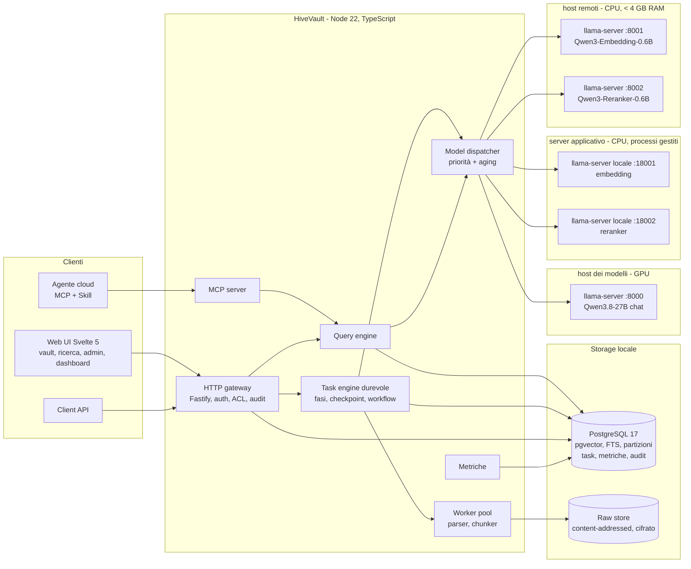

# HiveVault — Piano di sviluppo

> Versione 0.4 · 2026-10-27 · Stato: **bozza da approvare**
> Implementazione TypeScript autonoma, **ispirata** al pattern LLM-Wiki di Karpathy. Task durevoli, workflow e wiki sono implementazioni nostre.

**Modifiche rispetto alla v0.1**

| Tema | Decisione |
|---|---|
| D1 Agente cloud e testo compilato | Accettato: l'agente cloud legge pagine `pubblico`/`interno` secondo la clearance; **l'utente viene avvisato** (§3.6). |
| D2 Workflow | Chiusa con la decisione sopra: DSL di workflow nostro sopra il task engine. |
| D3 Frontend | Svelte 5 + Vite. |
| D4 Modelli | Locali, su un host dei modelli raggiungibile in rete (`<host-modelli>:8000`) (§2.4). |
| D5 Scala | Diversi **TB** di documenti → **PostgreSQL + pgvector da subito** (§3, §6). |
| D6 OTP | Solo TOTP. |
| D7 Embedding/reranker (v0.3) | Nessuna VRAM libera sull'host del 27B → modelli piccoli (< 4 GB di RAM in totale) su un **host separato**, in CPU (§2.4). |
| D8 Hardware (v0.3) | Server di sviluppo: 64 GB di RAM, 100 GB di disco libero → dataset di sviluppo e spike ridimensionati; dimensionamento della produzione per formula (§2.5). |
| D9 Campione (v0.3) | Nessun campione reale: stime generiche, corpus sintetico + corpus pubblici; il sistema misura i rapporti reali in produzione (§0.1, §10). |
| D10 Dove girano embedding/reranker (v0.4) | Entrambe le modalità, anche insieme: processi `llama-server` locali gestiti dal server (CPU, thread limitati) + endpoint remoti; il dispatcher verifica che il modello sia identico ovunque (§2.4). |

---

## 0. Sintesi

**HiveVault** è un server self-hosted che mantiene la memoria di un'azienda come **memoria alveare**:

- ogni **cella** (persona, edge, team, progetto) ha un **vault** proprio, indicizzato e isolato;
- sopra le celle c'è l'**alveare**: pagine collettive ottenute promuovendo, unendo e riconciliando la conoscenza delle celle, con la provenienza conservata;
- la conoscenza è **compilata** (LLM-Wiki): i documenti aggiornano pagine di entità, concetti, decisioni e timeline collegate da `[[link]]`, e il ciclo notturno le ottimizza;
- il formato è **progettato per l'agente cloud**: indice gerarchico, riassunti a più livelli, numero di token per risultato, citazioni stabili, server MCP e Skill;
- **i documenti originali non escono mai dal server**: parsing, embedding, compilazione e ciclo notturno usano solo modelli in LAN.

### 0.1 Cosa cambia con "diversi TB"

Ordini di grandezza **generici** (non c'è un campione reale, D9): sono ipotesi di progetto. In produzione la dashboard "Ingestion" misura i rapporti reali (testo/volume, token/GB, chunk/documento) e ricalcola le stime di spazio e di tempo.

| Grandezza | Stima per 1 TB di documenti misti |
|---|---|
| Testo estraibile | 3–10% del volume → 30–100 GB di testo |
| Token | ~8–25 miliardi |
| Chunk da ~500 token | **15–50 milioni** per TB |
| Vettori 1024 dim `halfvec` | 2 KB/chunk → 30–100 GB per TB (più l'indice HNSW) |

Conseguenze che guidano tutto il piano:

1. **Non tutto può passare dall'LLM.** Con un solo llama-server, un modello 27B e una richiesta alla volta (`-np 1`), compilare con l'LLM ogni documento richiederebbe anni. Quindi l'ingestion è **a livelli** (§4.1): *tutti* i documenti vengono parsificati, indicizzati e resi cercabili (non serve l'LLM); la compilazione nel wiki si fa **in modo selettivo e progressivo**, partendo da ciò che conta (caricamenti degli utenti, documenti recenti, entità molto citate o cercate) e, su richiesta, quando una ricerca tocca documenti non ancora compilati.
2. **Anche gli embedding sono un collo di bottiglia, e girano in CPU (D7).** Un modello da 0,6B in CPU produce indicativamente 1–4k token/s per host (da misurare nello spike D): l'intero archivio richiederebbe **mesi**. Quindi gli embedding seguono la stessa logica a priorità della compilazione: caricamenti degli utenti, documenti recenti e spazi più consultati per primi; il resto avanza in background. La ricerca **BM25 è disponibile su tutto da subito**; la copertura semantica cresce nel tempo ed è visibile. Il carico si distribuisce aggiungendo istanze di embedding su altre macchine (il dispatcher le usa in parallelo).
3. **Partizionamento obbligatorio.** Tabelle partizionate per vault/spazio: una ricerca tocca solo le partizioni consentite (isolamento + prestazioni).
4. **Import massivo.** Diversi TB non si caricano dal browser: serve un **importatore da cartella/condivisione locale** (SMB/NFS montata, archivi di posta) gestito dall'admin (§4.4).

### 0.2 Obiettivi di prestazione (da confermare con lo spike C)

| Operazione | Target p95 | Condizioni |
|---|---|---|
| Ricerca ibrida, spazi consentiti ≤ 5M chunk | < 200 ms | senza rerank |
| Ricerca ibrida su tutto l'alveare (50M chunk) | < 600 ms | HNSW + partition pruning |
| Rerank locale top 20 (CPU) | + 0,3–1 s | opzionale, da misurare nello spike D |
| Lettura pagina con budget di token | < 20 ms | — |
| Ingestion livello 1 (parse+chunk+BM25) | ≥ 50 pagine/s per worker | senza GPU |
| Embedding | limitato dalla CPU dell'host embedding, misurato in dashboard | batch 32, più istanze in parallelo |
| Ciclo notturno | finestra configurabile (default 01:00–06:00) | riprende la notte dopo |

---

## 1. Analisi dei requisiti

### 1.1 Requisiti funzionali

| ID | Requisito | Note di analisi |
|---|---|---|
| F1 | L'amministratore crea e gestisce (CRUD) account utente e account API | Account API = identità non umane con scope, vault consentiti, clearance, scadenza. |
| F2 | Accesso via **TOTP**, **passkey** o **challenge** | TOTP = RFC 6238 (app authenticator); passkey = WebAuthn; challenge = **firma** di `{origine del server, username, nonce, ts}` con la chiave privata o il certificato dell'utente (Ed25519 / ECDSA P-256 / X.509). Il "nome utente cifrato dalla chiave" si implementa come firma: prova il possesso della chiave, il nonce monouso impedisce il replay e l'origine impedisce che un altro server inoltri la firma. |
| F3 | CRUD completa dell'intero sistema per l'admin | Utenti, account API, celle, spazi, permessi, sorgenti, pagine, job, import, modelli, impostazioni, audit. |
| F4 | Dashboard tematiche in stile Grafana | Griglia di pannelli, intervallo di tempo, refresh, variabili, drill-down; `/metrics` Prometheus. |
| F5 | Temi UI | `notte`, `carta`, `ufficio`, `colorato` (§9.1). |
| F6 | L'utente sfoglia e cerca nella propria memoria | Navigazione stile Obsidian. |
| F7 | L'utente sfoglia e cerca nella memoria aziendale consentita | ACL applicata *prima* della query (partition pruning + RLS). |
| F8 | Upload di pdf, word, excel, pptx, immagini, eml/msg/mbox, csv, md, txt, link | Parser locali; l'originale resta sul server. |
| F9 | Ingestion in differita | Coda durevole con priorità, stato visibile per documento. |
| F10 | Ottimizzazione notturna | Ciclo "dream" (§5). |
| F11 | Navigazione Obsidian-like con markdown e link | `[[wikilink]]`, backlink, hover preview, grafo, quick switcher, schede e pannelli. |
| F12 | Consultazione ottimale dall'agente cloud | MCP, Skill, `llms.txt`, budget di token. |

### 1.2 Requisiti non funzionali

| ID | Requisito | Scelta |
|---|---|---|
| N1 | Documenti sempre in locale | Raw store cifrato su disco locale; parser e modelli in LAN; guardia sull'uscita di rete con allowlist degli host dei modelli; i raw non sono mai esposti via MCP. |
| N2 | Prestazioni a scala TB | PostgreSQL 17 + pgvector, partizionamento, HNSW su `halfvec`, FTS con GIN, pool di connessioni, cache per versione (§6). |
| N3 | Durabilità | Task engine nostro su Postgres: fasi, checkpoint, idempotenza, ripresa dopo crash (§2.2). |
| N4 | Isolamento | Partizioni per vault + Row Level Security come seconda difesa + test dedicati. |
| N5 | Audit | Ogni lettura API/MCP e ogni modifica registrata. |
| N6 | Grafica professionale | Design system unico, tastiera prima di tutto, WCAG 2.1 AA. |
| N7 | Lingua | UI in italiano; contenuti IT/EN → embedding multilingua e FTS `italian`/`english`. |
| N8 | Backup | `pgBackRest` (full + WAL, ripristino point-in-time) + snapshot del raw store. |

### 1.3 Punti critici

1. **Capacità del modello unico.** Vedi §0.1: compilazione selettiva, dispatcher con priorità, BM25 subito disponibile.
2. **Il server dei modelli è oggi spento.** Lo sviluppo usa un **provider finto** (risposte registrate) e un provider OpenAI-compatibile reale dietro la stessa interfaccia. I test di qualità con il modello vero si fanno quando l'host è acceso.
3. **Embedding e reranker non esistono sul setup esistente** e l'host del 27B non ha VRAM libera. Due istanze llama-server piccole girano in CPU su un host separato (§2.4).
4. **Invariante:** sull'host dei modelli non si modificano file, modelli né configurazione; HiveVault usa solo gli endpoint HTTP.

---

## 2. Architettura



### 2.1 Stack

| Livello | Scelta | Motivo |
|---|---|---|
| Runtime | Node.js 22+, TypeScript strict, ESM | — |
| HTTP | **Fastify** | Throughput 2–3× Express, schema JSON per validazione e serializzazione. |
| Database | **PostgreSQL 17 + pgvector ≥ 0.8** | Scala TB, `halfvec`, HNSW con iterative index scan (filtri + vettori), FTS integrato, partizioni, RLS, `SKIP LOCKED` per le code, `LISTEN/NOTIFY`. |
| Accesso al DB | `postgres` (porsager) + SQL esplicito, migrazioni con un runner interno (file SQL numerati, checksum, advisory lock) | Query ottimizzabili a mano; nessun ORM tra noi e gli indici. |
| Pool | `pgbouncer` (transaction mode) | Migliaia di richieste brevi senza esaurire le connessioni. |
| Raw store | filesystem locale content-addressed: l'indirizzo è lo `sha256` del contenuto (database e interfaccia `BlobStore`), il nome del file è `k/ab/cd/<HMAC-SHA256(chiave dei nomi del vault, sha256)>`. I file con il nome delle versioni precedenti (`ab/cd/<sha256>`) cambiano nome al primo avvio del server: il cambio è senza ritorno, le versioni precedenti non leggono i nomi nuovi | Semplice e veloce; senza la chiave, una copia dei file non mostra quali documenti noti contiene; un'implementazione S3-compatibile locale (es. Garage/SeaweedFS) si aggiunge dietro la stessa interfaccia se servono più nodi. |
| Modelli | llama-server OpenAI-compatibile (§2.4) | — |
| Frontend | **Svelte 5 + Vite + TypeScript** | Deciso (D3). |
| Editor | **CodeMirror 6** con live preview | Come Obsidian. |
| Markdown | `markdown-it` + plugin wikilink, callout, tabelle, mermaid, KaTeX; rendering lato server con cache per hash | — |
| Grafo | **sigma.js + graphology** (WebGL) | Decine di migliaia di nodi. |
| Grafici | **uPlot** (serie temporali) + ECharts per heatmap/sankey | — |
| Auth | `@simplewebauthn/server`, `otplib`, `node:crypto` | Nessun servizio esterno. |
| Deploy | Docker Compose: `postgres` (immagine pgvector), `pgbouncer`, `app`, `parser-sidecar` (opzionale) | Installazione ripetibile su Linux; sviluppo anche su Windows. |

### 2.2 Concetti di base, implementati da noi

Il progetto non dipende da framework esterni per agenti. Implementa questi concetti:

| Ispirazione | Concetto | Implementazione in HiveVault |
|---|---|---|
| **Task durevoli** | Task = macchina a stati con checkpoint per fase; intent del tool salvato prima dell'esecuzione; tool `replaySafe`; `requestId` idempotente; `sleepUntil` durevole; task figli; usage per conversazione | `packages/tasks`: tabella `tasks` (stato, fase, checkpoint JSONB, `run_after`, tentativi, owner), `task_events` (journal append-only). Worker che prendono i task con `FOR UPDATE SKIP LOCKED`, risveglio con `LISTEN/NOTIFY`. Al riavvio: una fase interrotta riparte dal checkpoint; un tool non `replaySafe` interrotto viene segnalato invece di ripetuto. |
| **Workflow estendibili** | `parallel()`, `pipeline()`, `checkpoint()` (approvazione umana), workflow deterministici e riprendibili | `packages/workflows`: piccole funzioni TS sopra il task engine. `parallel` crea task figli e aspetta; `pipeline` concatena fasi; `checkpoint` crea una voce nella coda di approvazione e sospende il task. Usato da ingestion e dream cycle. |
| **LLM-Wiki** | `SCHEMA.md`, `index.md`, `log.md`, cartelle `entities/concepts/summaries`, frontmatter, ingest/query/lint | Modello dati delle pagine (§3), operazioni ingest/query/lint come workflow, export compatibile Obsidian. |
| **pi-memory** | Fatti e preferenze durevoli | Tabella `claims` (affermazioni atomiche con fonte) e note rapide in `_inbox`. |

### 2.3 Struttura del repository (npm workspaces)

```
hivevault/
├── AGENTS.md / CLAUDE.md          # regole per gli agenti che sviluppano il progetto
├── docker-compose.yml
├── packages/
│   ├── shared/      # tipi, schema frontmatter, ULID, token counting, errori
│   ├── db/          # migrazioni, partizioni, RLS, repository SQL
│   ├── blobs/       # BlobStore (fs, cifratura AES-256-GCM)
│   ├── tasks/       # task engine durevole
│   ├── workflows/   # parallel / pipeline / checkpoint
│   ├── models/      # dispatcher con priorità e aging, provider llama-server, provider finto
│   ├── parsers/     # un parser per formato + pool di worker + sidecar opzionale
│   ├── brain/       # chunking, embedding, compilazione wiki, grafo, query, budget
│   ├── jobs/        # ingestion, import massivo, dream cycle, manutenzione
│   ├── auth/        # TOTP, passkey, challenge, sessioni, API key, RBAC/ACL, audit
│   ├── metrics/     # raccolta, rollup, query, export Prometheus
│   ├── mcp/         # server MCP
│   ├── server/      # Fastify: REST, SSE, static
│   └── web/         # SPA Svelte 5
├── skills/          # Skill per l'agente cloud
├── .claude-plugin/  # plugin per l'agente cloud
├── bench/           # dataset sintetici e benchmark
├── eval/            # set di domande per la qualità del recupero
└── docs/
```

### 2.4 Modelli locali

```env
# Chat / compilazione
LLAMA_SERVER_URL=http://<host-modelli>:8000
LLAMA_MODEL_ID=<percorso-del-modello>.gguf
LLAMA_PARALLELISM=1
LLAMA_MAX_TOKENS=16384
LLAMA_CONTEXT_TOKENS=            # vuoto = letto da GET /props
LLAMA_TEMPERATURE=0.2
LLAMA_REQUEST_TIMEOUT_MS=1200000
LLAMA_IDLE_TIMEOUT_MS=180000
LLAMA_AGING_MS=600000            # una richiesta in attesa sale di priorità ogni 10 min

# Nuovi: embedding e reranker in CPU (D7), locali e/o remoti (D10)
EMBED_MODEL_ID=Qwen3-Embedding-0.6B-Q8_0.gguf   # ~0,65 GB, multilingua (IT/EN), Matryoshka
EMBED_DIMENSIONS=1024                           # troncamento a 512 valutato nello spike C
RERANK_MODEL_ID=Qwen3-Reranker-0.6B-Q8_0.gguf   # ~0,65 GB

# Locale: il server avvia e sorveglia i propri processi llama-server
LOCAL_MODELS_ENABLED=true
LOCAL_LLAMA_BIN=/opt/llama.cpp/llama-server     # binario llama.cpp installato dall'admin
LOCAL_MODELS_DIR=data/models                    # file .gguf copiati dall'admin
LOCAL_EMBED_PORT=18001                          # solo 127.0.0.1
LOCAL_RERANK_PORT=18002
LOCAL_MODELS_THREADS=8                          # tetto ai core usati: CPU lasciata a Postgres e ai parser
LOCAL_MODELS_SCHEDULE=always                    # always | off-hours (es. 19:00-07:00) | on-demand

# Remoti: zero o più istanze su altre macchine (lista separata da virgole)
REMOTE_EMBED_URLS=http://<host-a>:8001,http://<host-b>:8001
REMOTE_RERANK_URLS=http://<host-a>:8002

MODELS_OFFLINE_MODE=mock                        # mock | queue: comportamento quando un endpoint è spento
```

**Due modalità, attive anche insieme (D10):**

| | Locale (server applicativo) | Remota (altre macchine) |
|---|---|---|
| Avvio | Il server avvia `llama-server` come processo figlio (`packages/models/local-supervisor`) | L'admin avvia `llama-server` sull'host remoto con i comandi sotto |
| Rete | Solo `127.0.0.1` | LAN; IP consentiti nella guardia di rete; token opzionale (`--api-key`) |
| Ciclo di vita | Supervisore: health check ogni 10 s, riavvio con backoff, log nella dashboard "Modelli", arresto pulito con il server | Solo health check; endpoint escluso quando non risponde e riprovato |
| Risorse | `--threads` limitato e priorità di processo bassa (`nice`/`BELOW_NORMAL`), così ricerca e Postgres restano reattivi; orario configurabile (`off-hours`) per lavorare a pieno ritmo di notte | Tutte le risorse dell'host |
| Gestione dalla UI admin | Avvio/arresto, thread, orario, modello in uso, RAM e token/s | Aggiunta/rimozione endpoint, test `/health`, token/s, latenza |
| Uso tipico | Sviluppo; installazioni piccole; sempre disponibile per le query interattive | Throughput per il backfill degli embedding: ogni macchina in più aggiunge capacità |

**Regole del dispatcher con endpoint misti:**
- **Stesso modello ovunque.** Vettori di modelli diversi non sono confrontabili. All'avvio e a ogni riconnessione il dispatcher legge `GET /props` (o `/v1/models`) di ogni endpoint e verifica nome del modello, quantizzazione e dimensione dei vettori rispetto a `EMBED_MODEL_ID`/`EMBED_DIMENSIONS`; un endpoint diverso viene rifiutato con un errore in dashboard. Ogni vettore salvato porta l'id del modello (`embedding_model`), così un cambio di modello futuro diventa una migrazione controllata e non una corruzione silenziosa.
- **Instradamento per priorità.** Le query interattive (`p0`, un solo testo da embeddare) vanno all'endpoint con la latenza più bassa, di solito quello locale. I batch di ingestion e backfill (`p1`/`p2`) vanno a tutti gli endpoint in proporzione al throughput misurato (token/s).
- **Ripiego.** Se tutti i remoti sono spenti, il locale fa tutto; se anche il locale è spento, si applica `MODELS_OFFLINE_MODE`.

**Budget di RAM per istanza (D7: < 4 GB, vale per il locale e per ogni host remoto):**

| Istanza | Modello (Q8_0) | Contesto / batch | RAM stimata |
|---|---|---|---|
| Embedding | ~0,65 GB | `-c 8192 -b 2048 -ub 2048`, 4 slot | ~1,2 GB |
| Reranker | ~0,65 GB | `-c 4096`, 2 slot | ~1,0 GB |
| **Totale** | | | **~2,2 GB** (margine sotto i 4 GB) |

Comandi per un host remoto (il supervisore locale usa gli stessi argomenti con `--host 127.0.0.1` e le porte locali):

```bash
llama-server -m Qwen3-Embedding-0.6B-Q8_0.gguf --embedding --pooling last -c 8192 -np 4 --host 0.0.0.0 --port 8001 --api-key <token>
llama-server -m Qwen3-Reranker-0.6B-Q8_0.gguf --reranking -c 4096 -np 2 --host 0.0.0.0 --port 8002 --api-key <token>
```

Per gli host remoti il repository include `scripts/embed-host/`: unit systemd (Linux) e servizio Windows con i comandi sopra, e un controllo che il modello sia lo stesso del server.

- Alternative se la qualità o la velocità in CPU non bastano: `bge-m3` (~0,6 GB in Q8, molto valido in italiano) per gli embedding; `bge-reranker-v2-m3` per il rerank. Lo spike D le confronta.
- Sul server di sviluppo (64 GB) gira la modalità locale; i test della modalità remota usano una seconda istanza su un'altra porta o un'altra macchina della LAN.
- Il rerank è **opzionale per query** (`rerank: true`), perché in CPU aggiunge 0,5–2 s sui top 50: si usa per `brain_ask` e per le ricerche dove la precisione conta più della latenza; di default si fa rerank sui top 20.

- **Dispatcher**: una coda per endpoint, parallelismo 1 sul modello di chat, priorità `p0` interattivo (ricerca, `brain_ask`) > `p1` ingestion > `p2` dream, con aging.
- **Host spento**: `mock` in sviluppo (risposte registrate, embedding deterministici da hash); `queue` in produzione: i task che richiedono il modello restano in attesa e riprendono da soli quando `/health` risponde. La ricerca BM25 continua a funzionare.
- Il dispatcher gestisce **endpoint multipli per tipo**: chat (1 endpoint, parallelismo 1), embedding (N endpoint, round-robin pesato sulla latenza misurata), rerank (1+). Un endpoint che non risponde a `/health` viene escluso e riprovato.

### 2.5 Dimensionamento (D8)

**Server di sviluppo: 64 GB RAM, 100 GB disco libero.** Budget di disco in sviluppo:

| Voce | Spazio |
|---|---|
| Postgres: dataset di sviluppo (~500k chunk, corpus pubblici + sintetici) | ~5 GB |
| Postgres: dataset dello spike C (5M chunk, poi eliminato) | ~35 GB |
| Raw store di sviluppo | ~10 GB |
| Modelli embedding/reranker (se ospitati qui) | ~1,5 GB |
| Backup, WAL, margine | ~25 GB |
| **Totale** | **~75 GB su 100** |

Postgres in sviluppo: `shared_buffers=12GB`, `effective_cache_size=40GB`, `maintenance_work_mem=4GB` (build HNSW), `work_mem=64MB`.

**Produzione: formula per TB di documenti** (ipotesi generiche §0.1, ricalcolate dalla dashboard con i dati reali):

| Componente | Per TB di documenti | Note |
|---|---|---|
| Raw store | ~1 TB (meno la deduplica, tipicamente 10–30% su email e allegati) | Dischi capienti, anche HDD |
| Testo dei chunk + `tsvector` + GIN | 60–200 GB | SSD/NVMe |
| Vettori `halfvec(1024)` | 30–100 GB | 15 GB–50 GB con 512 dimensioni |
| Indice HNSW | ~1–1,5× i vettori | Deve stare **in RAM** per le prestazioni |
| Pagine wiki, link, claims, metadati | < 5 GB | — |
| **DB totale** | **~150–450 GB per TB** | NVMe |
| RAM consigliata | 64 GB fino a ~10M chunk; 128–256 GB oltre, **oppure** `pgvectorscale` (StreamingDiskANN, indice su disco) o vettori binari con rescoring | Decisione dopo lo spike C |

Il progetto non dipende dall'hardware di produzione: le soglie sono parametri, e la dashboard "Database" segnala quando l'indice vettoriale non sta più in cache.

---

## 3. Il modello della memoria

### 3.1 Livelli

| Livello | Contenuto | Chi lo scrive | Mutabile |
|---|---|---|---|
| **L0 Raw** | File originale, indirizzato per SHA-256, cifrato (chiave per vault) | Upload / import | No |
| **L1 Estratto** | Testo normalizzato in markdown + metadati + chunk + embedding | Parser + chunker | Rigenerato se cambia il parser |
| **L2 Wiki della cella** | Pagine compilate: entità, concetti, decisioni, riassunti, sintesi | LLM locale + utente | Sì, con versioni |
| **L3 Alveare** | Pagine collettive per spazio aziendale | Dream cycle + curatori | Sì, con versioni e provenienza |
| **Schema** | `SCHEMA.md` per vault: tipi, convenzioni, regole di compilazione | Admin / curatori | Sì |

### 3.2 Celle e alveare

- **Cella** = vault con proprietario: `user:<id>`, `edge:<id>`, `team:<id>`, `project:<id>`.
- **Alveare** = spazi (`hive:clienti`, `hive:progetti`, `hive:tecnico`…) con ACL `read` / `write` / `curate` / `admin`.
- **Promozione** cella → alveare nel dream cycle: affermazioni concordi da più celle unite (con conteggio delle fonti); contraddizioni → blocco `> [!conflict]` e voce nella coda curatori; ogni frase porta la provenienza `^[cella:pagina#blocco]`; il ritiro di un'informazione nella cella si propaga.
- **Visibilità**: `privato` · `team` · `azienda`. **Classificazione**: `pubblico` · `interno` · `riservato` · `segreto`.

### 3.3 Fonte di verità e compatibilità Obsidian

A scala TB la **fonte di verità è Postgres** (pagine, versioni, link). Il formato resta compatibile con Obsidian:

- export di un vault come cartella `SCHEMA.md`, `index.md`, `log.md`, `llms.txt`, `wiki/{entities,concepts,decisions,sources,syntheses,_inbox}/*.md`;
- import di un vault Obsidian esistente (markdown + `[[link]]`);
- sincronizzazione opzionale bidirezionale per i vault piccoli (cella personale).

### 3.4 Formato di pagina ottimizzato per l'agente cloud

```markdown
---
id: ent_01JB8K3...            # ULID stabile: i link sopravvivono ai cambi di titolo
title: Acme S.p.A.
type: entity/company
aliases: [Acme, ACME spa]
tldr: Cliente fintech dal 2024; contratto SaaS 500 posti; referente tecnico Nome CognomeAAA.
tags: [cliente, fintech]
visibility: azienda
classification: interno
sources: [src_7f3a..., src_91bc...]
confidence: 0.86
updated: 2026-10-26
tokens: 742
---

# Acme S.p.A.

## Stato attuale            ← "compiled truth", riscritta a ogni aggiornamento
- Contratto SaaS 500 posti, rinnovo 2027-03 ^[src_7f3a#c12]
- Referente tecnico: [[Nome CognomeAAA]] ^[src_91bc#c3]

## Questioni aperte
- [ ] Security review del nuovo piano (scadenza 2026-11-01) ^[src_91bc#c7]

## Timeline                 ← append-only, prove datate
- 2026-10-22 · Call prezzi con [[Nome CognomeAAA]] ^[src_91bc]
- 2026-04-10 · Firma contratto ^[src_7f3a]

## Vedi anche
[[Progetto Atlas]] · [[Piano Enterprise]]
```

- `tldr` e "Stato attuale" in testa: disclosure progressiva, l'agente cloud può fermarsi presto.
- `tokens` precalcolato: il server taglia per budget senza ricontare.
- Citazioni `^[src#chunk]` stabili e risolvibili con `brain_source`. Una frase compilata senza fonte viene scartata.
- "Stato attuale" + "Timeline": la parte letta sempre resta corta, le prove si accumulano sotto.
- Blocchi indirizzabili (`#^blockid`): lettura e citazione per porzioni, visibilità per blocco.

### 3.5 Schema PostgreSQL (essenziale)

Tutte le tabelle grandi sono **partizionate per `vault_id`** (`PARTITION BY LIST`, una partizione per vault grande, partizioni `HASH` per le celle piccole). Ogni query porta `vault_id = ANY($consentiti)` → partition pruning.

| Tabella | Contenuto | Indici |
|---|---|---|
| `vaults` | id, tipo (cella/spazio), owner, schema_md, versione | — |
| `pages` | id, vault_id, title, type, tldr, body_md, visibility, classification, tokens, hash, importance, updated_at | btree (vault, type, updated), trigram su title |
| `page_versions` | storico (diff) | (page_id, version) |
| `aliases` | vault_id, alias normalizzato → page_id | unique → risoluzione `[[link]]` in O(1) |
| `blocks` | page_id, block_id, heading_path, offset, tokens | lettura per sezione |
| `sources` | sha256, vault_id, mime, nome, size, stato pipeline, livello raggiunto, parser_version, priority | (stato, priority) |
| `chunks` | id, vault_id, source_id \| page_id, text, tokens, lang, hash, `tsv tsvector` (generata: `italian` o `english` per lingua + `simple` per codici e nomi), `embedding halfvec(1024)` | **GIN** su `tsv`; **HNSW** `halfvec_cosine_ops` per partizione (m=16, ef_construction=64); btree su hash |
| `links` | src_page, dst_page, dst_unresolved, kind (wikilink, mention, `works_at`, `owns`, `decided_by`…) | entrambe le direzioni |
| `claims` | soggetto, predicato, oggetto, fonte, data, confidenza, stato | per entità; base per merge e contraddizioni |
| `tasks`, `task_events` | task engine (§2.2) | (stato, run_after, priority) parziale sui task attivi |
| `metrics_*` | serie temporali partizionate per giorno + rollup | BRIN sul tempo |
| `audit_log` | partizionato per mese | BRIN sul tempo |

**Row Level Security** su `pages`, `chunks`, `sources`: la sessione imposta `app.principal` e `app.clearance`; le policy filtrano vault e classificazione. Il filtro applicativo resta la prima difesa; RLS è la seconda, contro i bug.

Da valutare nello spike C: **ParadeDB `pg_search`** (BM25 vero, più veloce del `ts_rank` su grandi volumi) e **`pgvectorscale`** (StreamingDiskANN, indice su disco per decine di milioni di vettori con poca RAM).

### 3.6 Uscita verso l'agente cloud e avviso all'utente (D1)

| Classificazione | UI interna | Modelli locali | Agente cloud via MCP |
|---|---|---|---|
| pubblico | ✔ | ✔ | ✔ |
| interno | ✔ | ✔ | ✔ se l'account API ha `clearance ≥ interno` |
| riservato | ✔ (ACL) | ✔ | ✖ |
| segreto | ✔ (ACL) | ✔ | ✖ sempre |

**Avviso all'utente:**
- al primo accesso: informativa che il testo compilato delle pagine `pubblico`/`interno` può essere letto dall'agente cloud (un servizio esterno) tramite gli account API autorizzati, mentre i documenti originali non escono mai; l'utente conferma la presa visione (registrata nell'audit);
- su ogni pagina: badge "Consultabile dall'agente cloud" quando la pagina è leggibile da almeno un account MCP;
- all'upload: la classificazione proposta è mostrata con lo stesso avviso e si può alzare prima della compilazione;
- per l'admin: la creazione di un account API con clearance `interno` mostra lo stesso avviso;
- nella cella personale: pannello "Cosa ha letto l'agente cloud" con le letture MCP delle proprie pagine (dall'audit).

Il filtro è applicato nel query engine **prima** del ranking e ripetuto da RLS.

---

## 4. Ingestion

### 4.1 Livelli di elaborazione (la chiave per la scala TB)

| Livello | Passi | Costo | Chi ci arriva |
|---|---|---|---|
| **I1 Indicizzato** | detect → parse → chunk → FTS | solo CPU | **tutti** i documenti |
| **I2 Semantico** | embedding dei chunk | CPU host embedding | tutti, in ordine di priorità |
| **I3 Compilato** | riassunto di sorgente, aggiornamento delle pagine entità/concetti/decisioni, claims, link | LLM 27B (`-np 1`) | selezione per priorità e su richiesta |

**Priorità di compilazione (I3):** caricamenti diretti degli utenti > documenti citati da pagine esistenti > documenti recenti > documenti delle entità più cercate > resto. **Compilazione su richiesta:** quando una ricerca restituisce chunk di documenti solo I1/I2, il documento sale in coda; la dashboard mostra la copertura per spazio (`% I1/I2/I3`).

### 4.2 Flusso (task durevole `ingest`, requestId = `sha256:vault`)

```
upload / import ─▶ BlobStore (sha256, cifrato, dedup) ─▶ 202 immediato
  [1] detect   mime reale (magic bytes), lingua, dimensione
  [2] parse    worker pool / sidecar → markdown L1 + metadati + allegati (ricorsivi)
  [3] chunk    per struttura (titoli, slide, fogli, thread email), 300–800 token, overlap 10%
  [4] index    COPY in chunks + tsv                                → I1: già cercabile (BM25)
  [5] embed    batch da 64, dedup per hash, priorità p1              → I2
  [6] compile  workflow LLM (solo se selezionato) con tool del vault:
               legge SCHEMA.md e indice delle entità, scrive sources/<doc>, aggiorna 5–15 pagine,
               estrae claims, aggiunge link, scrive log                → I3
  [7] classify proposta di classificazione e visibilità (regole + LLM)
  [8] notify   SSE all'utente, log, metriche
```

Ogni passo è una fase con checkpoint. I tool in sola lettura sono `replaySafe`; quelli di scrittura sono idempotenti (scrivono per id + hash).

### 4.3 Parser (tutti locali)

| Formato | Parser | Note |
|---|---|---|
| PDF | `pdfjs-dist` → sidecar **docling** per tabelle e layout complessi | Scansioni → OCR |
| DOCX | `mammoth` | Titoli, liste, tabelle |
| XLSX / CSV | `exceljs` (streaming) / `papaparse` | Fogli piccoli → tabella markdown; grandi → schema + statistiche per colonna + righe campione; dati interrogabili come tabella temporanea |
| PPTX | XML via `jszip`: titolo, testo, note per slide | Una sezione per slide |
| EML / MSG / MBOX / PST | `mailparser`, `@kenjiuno/msgreader`; PST via sidecar (`readpst`) | Thread ricostruiti, firme e citazioni ripetute eliminate, allegati ricorsivi, dedup delle email duplicate tra caselle |
| Immagini | OCR `tesseract.js` (ita+eng); modello visione locale se disponibile | — |
| MD / TXT | nativo | Frontmatter preservato |
| Link esterni | `undici` + `@mozilla/readability` + `turndown` | Unico traffico in uscita: scarica la pagina verso il server; la copia diventa L0 |
| Codebase (zip / repo git) | albero + `tree-sitter` per simboli | Pagina per modulo + mappa del repository |

Interfaccia: `Parser { mimes, version, parse(stream, ctx) → { markdown, meta, attachments[] } }`. Il dream cycle ri-parsifica solo le sorgenti con `parser_version` vecchia.

### 4.4 Import massivo (admin)

- Sorgente: cartella locale o condivisione montata (SMB/NFS), archivi di posta (MBOX/PST), zip.
- Scansione incrementale (percorso + mtime + size, poi hash) → nessun file letto due volte; riprende dopo interruzioni.
- Mappatura cartella → vault/spazio e classificazione di default; regole di esclusione (glob, dimensione, estensioni).
- Limiti di velocità (I/O, CPU) e finestre orarie per non disturbare l'uso interattivo.
- Avanzamento in dashboard: file scansionati, I1/I2/I3, errori per parser, stima del tempo residuo.

---

## 5. Ciclo notturno ("dream cycle")

Workflow durevole per vault, risvegliato da `sleepUntil` alla finestra notturna. Budget di tempo e token per vault; se non finisce, riprende la notte dopo dal checkpoint.

| # | Passo | Tipo | Effetto |
|---|---|---|---|
| 1 | Re-parse delle sorgenti con parser obsoleti | deterministico | L1 aggiornato |
| 2 | Avanzamento del backlog I2/I3 nel tempo libero dei modelli | modello | copertura che cresce ogni notte |
| 3 | Deduplica entità (alias, similarità di titolo/tldr, regole) | LLM | merge con redirect, nessun link rotto |
| 4 | Crosslink: menzioni non collegate → `[[link]]` | deterministico + LLM per i casi ambigui | grafo più denso |
| 5 | Lint: orfani, link rotti, pagine stantie, contraddizioni tra claims | deterministico + LLM | voci in `_inbox` e coda curatori |
| 6 | Ricompilazione di "Stato attuale" e `tldr` delle pagine cambiate | LLM | pagine corte e aggiornate |
| 7 | Promozione all'alveare (§3.2) | LLM | proposte, merge, conflitti; `checkpoint()` per i merge a bassa confidenza |
| 8 | Importanza (accessi, backlink, recenza) e decadimento | deterministico | ranking migliore |
| 9 | Rigenerazione indici per categoria e `llms.txt` | deterministico | navigazione rapida per l'agente cloud |
| 10 | Manutenzione DB: `VACUUM (ANALYZE)` mirato, `REINDEX CONCURRENTLY` degli HNSW degradati, creazione partizioni future, pulizia metriche e audit oltre la ritenzione | deterministico | latenza stabile |
| 11 | Verifica backup (`pgBackRest check`) e snapshot del raw store | deterministico | ripristino garantito |
| 12 | Rapporto → `log` del vault + dashboard "Dream" | deterministico | trasparenza |

I passi LLM usano `parallel()` sui vault indipendenti, ma tutte le chiamate passano dal dispatcher: il parallelismo reale sul modello di chat resta 1.

---

## 6. Query engine e prestazioni

### 6.1 Ricerca ibrida

```
query ─▶ normalizza, lingua ─┬─▶ FTS: websearch_to_tsquery + ts_rank_cd (o pg_search BM25), top 200 ┐
                             ├─▶ embedding query (cache LRU) ─▶ HNSW halfvec top 200              │
                             │     (iterative index scan con filtro vault/classificazione)         │
                             ├─▶ match esatto titolo/alias (trigram)                               │
                             └─▶ (opz.) espansione grafo 1 hop dalle entità trovate               ┘
                                         │
              RRF (k=60) + boost: tipo pagina, importanza, recenza, livello I3 > I2 > I1, alveare/cella
                                         │
              (opz.) rerank locale top 20 → raggruppa per pagina → snippet → taglio a budget token
```

- **ACL**: `vault_id = ANY($consentiti)` → partition pruning; RLS come seconda difesa.
- **Una sola query SQL** per i rami FTS, vettore e alias (CTE + RRF in SQL): un solo round-trip.
- **Cache** dei risultati per `(principal, query normalizzata, versione dei vault)`; la versione cambia a ogni commit → invalidazione esatta.
- **Tuning Postgres** (macchina con molta RAM): `shared_buffers` 25% RAM, `effective_cache_size` 75%, `maintenance_work_mem` alto per costruire gli HNSW, `hnsw.ef_search` 40–100 per query, `max_parallel_workers_per_gather` per le scansioni FTS.
- **Scrittura in blocco**: `COPY` per chunk ed embedding; HNSW costruito dopo i caricamenti massivi iniziali di ogni partizione, poi aggiornato in modo incrementale.
- **Memoria dei vettori**: `halfvec` (metà spazio di `vector`); se lo spike lo conferma, embedding a 512 dimensioni (Matryoshka) e/o indice binario (`binary_quantize`) con rescoring.
- **HTTP**: compressione, ETag sulle pagine, HTML pre-renderizzato in cache per hash.

### 6.2 Budget di token (per l'agente cloud)

Ogni tool restituisce `tokens` per elemento e accetta `max_tokens`. Ordine di riempimento: `tldr` → "Stato attuale" → sezioni pertinenti alla query → timeline recente → chunk sorgente. Per i documenti non compilati (I1/I2) si restituiscono i chunk migliori con la loro citazione.

---

## 7. Interfaccia per l'agente cloud

### 7.1 Server MCP (streamable HTTP, account API)

| Tool | Scopo | Note |
|---|---|---|
| `brain_overview` | Vault/spazi accessibili, conteggi, categorie, copertura I1/I2/I3, ultimi aggiornamenti | Primo passo; risposta stabile → buona per il prompt caching |
| `brain_search` | Ricerca ibrida con filtri (vault, tipo, tag, date, livello) | id, titolo, tldr, snippet, punteggio, `tokens` |
| `brain_read` | Pagina per id/titolo, `sections`, `max_tokens` | Taglio §6.2 |
| `brain_neighbors` | Backlink, link, relazioni tipizzate, profondità 1–2 | Domande relazionali |
| `brain_timeline` | Eventi di un'entità o di un periodo | — |
| `brain_source` | Risolve `^[src#chunk]` nel testo del chunk | Mai il file raw |
| `brain_ask` | (opzionale) risposta sintetizzata dal modello locale con citazioni e lacune | — |
| `brain_capture` | Salva nota/sintesi nella cella dell'utente (`_inbox`) | Le buone risposte tornano nella memoria |
| `brain_propose_edit` | Propone una modifica; un umano approva | Niente scritture dirette nell'alveare |

Resource: `brain://<vault>/index`, `brain://<vault>/page/<id>`, `brain://<vault>/llms.txt`. Prompt: `prepara-riunione`, `stato-cliente`, `cosa-sappiamo-di`. Pochi tool ben descritti: meno token di definizione, scelte più affidabili.

### 7.2 Skill e plugin

- `skills/hivevault-query/SKILL.md`: overview → search → read con budget → neighbors; come citare; quando dire "la memoria non lo sa".
- `skills/hivevault-ingest/SKILL.md`: caricare e verificare lo stato.
- `.claude-plugin/`: installa MCP + skill nel client dell'agente.

---

## 8. Autenticazione, autorizzazione, amministrazione

### 8.1 Metodi di accesso

| Metodo | Flusso | Dettagli |
|---|---|---|
| **TOTP** | username → codice a 6 cifre (app authenticator) | Segreto cifrato a riposo; finestra ±1 step; codice non riutilizzabile nello stesso step; 10 codici di recupero monouso; blocco progressivo dopo tentativi falliti. Registrazione via QR mostrato una volta. |
| **Passkey** | WebAuthn (discoverable credentials) | Più passkey per utente; RP ID = dominio del server; richiede HTTPS (CA locale: `scripts/dev-ca.sh`). |
| **Challenge** | `GET /auth/challenge` → nonce (32 B, TTL 60 s, monouso) → firma di `cb-auth-v2\|origine\|username\|nonce\|ts` → `POST /auth/challenge` | Ed25519 / ECDSA P-256 o certificato X.509 della CA interna (catena + revoca). Per edge e script; CLI `cb login --key`. L'origine (`schema://host[:porta]`) è quella dell'URL che il client usa, presa dalla sua configurazione e mai dal server. Il server accetta solo le sue origini (`PUBLIC_URL`, `WEBAUTHN_EXTRA_ORIGINS`): una firma fatta per un altro server non vale. Il messaggio vecchio `cb-auth-v1` riceve l'errore `signature_outdated`, un'origine non accettata (campo `origin`) riceve `origin_mismatch`: nessuna sessione, nessun conteggio per il blocco. |
| **Account API** | API key `cb_<id>_<secret>` (hash salato) oppure challenge con chiave | Scope (`read`, `write`, `ingest`, `admin`), vault consentiti, clearance, scadenza, rate limit, IP consentiti. |

Il primo admin si crea da CLI (`cb admin create`) con registrazione TOTP obbligatoria. Sessioni: token opaco in cookie `HttpOnly; Secure; SameSite=Strict`, rinnovo scorrevole, revoca dall'admin; CSRF token per le modifiche; audit di ogni login.

### 8.2 Autorizzazione

RBAC (`admin`, `curatore`, `membro`, `api`) + ACL per vault/spazio (`read`, `write`, `curate`, `admin`) + clearance. Una sola funzione `authorize(principal, action, resource)` per REST, MCP e job, con test di tabella; le stesse regole generano le policy RLS.

### 8.3 Console amministratore (CRUD completa)

Utenti (reset TOTP, revoca sessioni) · account API (rotazione, "mostra una volta") · passkey e chiavi · celle e spazi · matrice permessi utente × spazio · sorgenti (stato, riprova, ri-parsa, forza compilazione, elimina a cascata) · import massivi · pagine (editor, storico, ripristino, merge) · coda curatori · task (in corso, falliti, riprova, annulla) · modelli (endpoint, test `/health`, stato della coda) · impostazioni (finestra notturna, budget, classificazione default, testo dell'avviso D1) · audit con ricerca · backup e ripristino.

### 8.4 Dashboard in stile Grafana

Pannelli su griglia (drag & resize, layout per utente), intervallo globale, refresh automatico, variabili (`$vault`, `$utente`, `$spazio`), drill-down dal grafico alla lista filtrata. Dati da tabelle di metriche partizionate per giorno con rollup 1 min / 1 h / 1 g e da `pg_stat_*`; `/metrics` Prometheus.

| Dashboard | Pannelli principali |
|---|---|
| **Panoramica** | documenti, TB, pagine, chunk, crescita, utenti attivi, query/min, stato dei modelli |
| **Ingestion e import** | coda per stato, throughput per formato, tempo per fase, errori per parser, **copertura I1/I2/I3 per spazio**, ETA del backlog |
| **Ricerca** | latenza p50/p95/p99 per ramo (FTS, vettore, rerank), hit-rate cache, query senza risultati, top query |
| **Salute della memoria** | orfani, link rotti, contraddizioni, pagine stantie, densità del grafo, copertura delle citazioni |
| **Alveare** | promozioni proposte/accettate/rifiutate, conflitti per spazio, contributo per cella |
| **Dream cycle** | durata per passo, budget usato, vault completati/rimandati, rapporto dell'ultima notte |
| **Modelli** | token/s, coda per priorità e per endpoint, attese, disponibilità dell'host |
| **Database** | dimensione per partizione, cache hit ratio, query lente (`pg_stat_statements`), bloat, stato HNSW, replica/backup |
| **Accessi e sicurezza** | login per metodo, fallimenti, account API attivi, letture MCP per classificazione, connessioni bloccate dalla guardia di rete |
| **Host** | CPU, RAM, disco (DB e raw store), I/O (riuso di `host-metrics.ts`) |

---

## 9. Interfaccia utente

### 9.1 Principi

- **Temi**: token CSS dei temi `notte`, `carta`, `ufficio`, `colorato`, script anti-flash (chiave `cb-theme`) e selettore a campioni. In Svelte diventano un file `tokens.css` globale; i componenti usano solo le variabili. Semantica: `--you` = richiede attenzione (conflitti, revisioni), `--busy` = in elaborazione, `--idle` = disponibile, `--alert` = errori; serie dei grafici da `--series-*`.
- **Tipografia**: `Recursive` per l'interfaccia, mono per metadati e codice; lettura a 68–72 caratteri per riga, interlinea 1.6.
- **Tastiera prima di tutto**: `Ctrl+K` palette comandi (da `palette.js`), `Ctrl+O` quick switcher, `Ctrl+Shift+F` ricerca, `Ctrl+\` dividi pannello, `Alt+←/→` cronologia.
- **Densità professionale**: barre laterali comprimibili, liste e tabelle virtualizzate (milioni di righe), skeleton, stati vuoti curati, micro-animazioni 120–180 ms.

### 9.2 Layout del vault (stile Obsidian)

```
┌──────────┬──────────────────────────────────────────┬─────────────┐
│ Vault ▾  │ [Acme S.p.A. ×] [Progetto Atlas ×] [+]    │ Struttura   │
│ ─────────│                                          │  Stato att. │
│ 🔍 Cerca │  # Acme S.p.A.   interno · azienda · ☁ Agente│  Timeline │
│ ★ Preferiti│  TL;DR Cliente fintech dal 2024…       │─────────────│
│ ▸ Entità │                                          │ Backlink (12)│
│ ▸ Concetti│  ## Stato attuale                       │─────────────│
│ ▸ Decisioni│  - Contratto… ¹                       │ Grafo locale│
│ ▸ Sorgenti│  - Referente [[Nome CognomeAAA]] ²          │   ◉─◉─◉     │
│ ▸ Inbox (3)│                                       │─────────────│
│ Alveare  │  Fonti: ¹ contratto.pdf p.3  ² mail 22/10│ Proprietà   │
│ ▸ Clienti│                                          │             │
└──────────┴──────────────────────────────────────────┴─────────────┘
```

Funzioni: schede e pannelli affiancati · hover preview dei `[[link]]` · backlink e menzioni non collegate · grafo globale e locale con filtri (tipo, tag, cella/alveare, profondità) e caricamento progressivo · vista sorgente: originale renderizzato dal server accanto al testo estratto, con evidenza del chunk citato · editor live preview con autocompletamento dei link · storico e diff · ricerca a faccette con anteprima e indicatore del livello (I1/I2/I3) · upload drag & drop con avanzamento SSE · coda "Da rivedere" · pannello "Cosa ha letto l'agente cloud".

### 9.3 Processo di design

1. Token e libreria componenti in una pagina "kitchen sink" per i 4 temi.
2. Mockup ad alta fedeltà di 6 schermate chiave (vault, ricerca, upload/import, admin utenti, dashboard, coda curatori) da approvare prima di sviluppare le viste.
3. Revisione accessibilità (contrasto nei temi chiari, focus, tastiera).

---

## 10. Piano per fasi

Stima per 1 sviluppatore senior assistito da un agente di programmazione. Ogni fase si chiude con criteri verificabili.

### Fase 0 — Fondamenta e spike (1,5 settimane) — ✅ completata il 2026-10-27, esiti in [docs/spikes/README.md](spikes/README.md)
- Monorepo, TS strict, lint, vitest, Docker Compose (Postgres 17 + pgvector, pgbouncer), `AGENTS.md`/`CLAUDE.md`.
- Provider modelli: finto (mock) + llama-server reale; dispatcher con priorità e aging; endpoint multipli con verifica del modello e instradamento per priorità/throughput.
- Supervisore dei processi locali (`local-supervisor`): avvio, health check, riavvio con backoff, limiti di thread e priorità, orario; testato su Windows e Linux. Script `scripts/embed-host/` per gli host remoti.
- **Spike A** — task engine: fasi, checkpoint, `SKIP LOCKED`, `LISTEN/NOTIFY`, crash simulato e ripresa.
- **Spike C** — scala: 5M chunk sintetici in partizioni (entro i 100 GB del server di sviluppo); misura FTS vs `pg_search`, HNSW `halfvec` 1024 vs 512 vs binario+rescoring, `pgvectorscale`; RAM, disco, latenze a 1M / 2M / 5M chunk ed **estrapolazione** a 50M → conferma dei target §0.2 e delle scelte §3.5.
- **Spike D** — embedding in CPU: Qwen3-Embedding-0.6B vs bge-m3, Qwen3-Reranker-0.6B vs bge-reranker-v2-m3; token/s, RAM (< 4 GB totali), qualità su un set di query IT/EN; throughput in modalità locale (thread limitati), remota e con le due insieme.
- **Corpus di sviluppo (D9)**: generatore sintetico (aziende, persone, progetti, email, verbali, offerte coerenti tra loro, con contraddizioni volute) + corpus pubblici in licenza libera (es. dataset di email Enron per eml/mbox, documenti pubblici della PA italiana in PDF/DOCX/XLSX, Wikipedia IT per testo lungo).
- Temi e kitchen sink in Svelte.
- ✅ Rapporto degli spike con numeri; scelte FTS/vettori chiuse.

### Fase 1 — Database e motore della memoria (2,5 settimane) — ✅ completata il 2026-10-27, esiti in [docs/spikes/README.md](spikes/README.md#fase-1--motore-della-memoria)
- Migrazioni, partizioni, RLS, repository SQL; BlobStore cifrato.
- Pagine, blocchi, alias, link, backlink, versioni; parser markdown/frontmatter/wikilink.
- Chunker strutturale, token counting, embedding con batch e dedup, FTS IT/EN.
- Query engine ibrido in una query, RRF, budget di token, cache per versione.
- Export/import Obsidian.
- ✅ Benchmark §0.2 su dataset sintetico; test di isolamento tra vault (applicativo e RLS).

### Fase 2 — Auth, ACL, API admin (1,5 settimane) — ✅ completata il 2026-10-27, esiti in [docs/spikes/README.md](spikes/README.md#fase-2--autenticazione-autorizzazione-api-di-amministrazione)
- TOTP, passkey, challenge (+ CLI), sessioni, API key, rate limit, audit, primo admin da CLI.
- `authorize()` unica + generazione policy RLS; CRUD REST completa; HTTPS con CA locale.
- ✅ Test e2e dei tre metodi; nessun risultato di vault altrui via REST o MCP (test dedicati).

### Fase 3 — Ingestion e import massivo (2,5 settimane) — ✅ completata il 2026-10-27, esiti in [docs/spikes/README.md](spikes/README.md#fase-3--ingestion-e-import-massivo); OCR e sidecar (docling, readpst) rinviati
- Upload in streaming, dedup; parser per tutti i formati, worker pool, sidecar (docling, readpst), OCR.
- Workflow `ingest` a livelli I1/I2/I3, priorità, compilazione su richiesta; agente di compilazione con tool del vault e `SCHEMA.md`.
- Import massivo da cartella/condivisione con scansione incrementale e limiti di velocità.
- Guardia di rete in uscita.
- ✅ Corpus di prova (20 file per formato) senza errori; kill durante la compilazione → ripresa senza duplicati; import di 1 milione di file sintetici con avanzamento corretto; nessuna connessione in uscita non consentita.

### Fase 4 — UI utente stile Obsidian (3 settimane) — ✅ completata il 2026-10-28, esiti in [docs/spikes/README.md](spikes/README.md#fase-4--interfaccia-utente-stile-obsidian)
- Shell, temi, palette, schede/pannelli; lettura ed editor; hover preview, backlink, struttura, proprietà.
- Ricerca a faccette, grafo globale e locale, vista sorgente affiancata.
- Upload con SSE, inbox, coda "Da rivedere", avvisi D1 e pannello "Cosa ha letto l'agente cloud".
- ✅ Test Playwright dei flussi principali nei 4 temi; Lighthouse ≥ 90; apertura pagina < 100 ms percepiti.

### Fase 5 — Alveare e dream cycle (2 settimane) — ✅ completata il 2026-10-28, esiti in [docs/spikes/README.md](spikes/README.md#fase-5--alveare-e-ciclo-notturno)
- Spazi, promozione, merge dei claims, conflitti, coda curatori.
- Dream cycle con i 12 passi, budget, ripresa, rapporto.
- ✅ Due celle con informazioni concordi e discordi → pagina d'alveare con provenienza e conflitto aperto; ciclo interrotto → ripresa la notte dopo.

### Fase 6 — MCP, Skill, plugin per l'agente cloud (1 settimana) — ✅ completata il 2026-10-28, esiti in [docs/spikes/README.md](spikes/README.md#fase-6--server-mcp-skill-e-plugin-per-lagente-cloud)
- 9 tool, resource, prompt; filtro classificazione; audit letture.
- Skill e plugin; `llms.txt`.
- Eval di recupero sul corpus sintetico (le risposte attese sono note perché il generatore conosce i fatti): 100 domande con risposte e pagine attese; recall@5, precisione delle citazioni, token medi per risposta, rilevamento delle contraddizioni volute (compilazione con il modello reale, all'accensione dell'host).
- ✅ recall@5 ≥ 0,85; nessuna pagina `riservato` restituita a clearance `interno`.

### Fase 7 — Console admin e dashboard (2 settimane) — ✅ completata il 2026-11-02, esiti in [docs/spikes/README.md](spikes/README.md#fase-7--console-di-amministrazione-e-dashboard)
- Viste CRUD complete, matrice permessi, task, import, audit, backup/ripristino.
- Pagina "Modelli": avvio/arresto e impostazioni dei processi locali, aggiunta/rimozione/test degli endpoint remoti, token/s e latenza per endpoint.
- Metriche, rollup, motore dei pannelli, le 10 dashboard, `/metrics`.
- ✅ Ogni entità gestibile dalla UI; dashboard fluide con 7 giorni di dati al minuto.

### Fase 8 — Hardening e rilascio (1,5 settimane) — ✅ completata il 2026-11-02 (senza l'ingestion continua di 24 h), esiti in [docs/spikes/README.md](spikes/README.md#fase-8--hardening-e-rilascio)
- Test di carico (k6), ingestion continua 24 h, profilazione query (`pg_stat_statements`, `EXPLAIN ANALYZE`).
- pgBackRest con ripristino verificato; revisione di sicurezza (OWASP ASVS L2).
- Documentazione ASD-STE 100 (installazione, operatore, admin, utente); script di installazione.
- ✅ Checklist di rilascio completa.

**Totale indicativo: 17–19 settimane** (+2 rispetto alla v0.1 per partizionamento, import massivo e task engine proprio). Fasi 4 e 7 (UI) parallelizzabili con 3 e 5 (backend).

---

## 11. Rischi e mitigazioni

| Rischio | Impatto | Mitigazione |
|---|---|---|
| Un solo modello 27B con `-np 1` per TB di dati | Compilazione completa impossibile | Ingestion a livelli; compilazione selettiva e su richiesta; copertura visibile; architettura pronta per più endpoint nel dispatcher |
| Embedding in CPU: backfill di mesi | Ricerca semantica parziale a lungo | BM25 su tutto da subito; embedding per priorità; dedup; più istanze su più macchine; copertura visibile |
| Rerank in CPU lento | Latenza alta | Rerank opzionale e su top 20 di default; cache dei risultati |
| Host dei modelli spento | Sviluppo e test bloccati | Provider mock; modalità `queue` in produzione; eval rimandate all'accensione |
| Stime generiche senza campione reale | Dimensionamento errato | Formula per TB (§2.5) e rapporti reali misurati in produzione; soglie parametriche |
| Disco di sviluppo limitato (100 GB) | Benchmark non rappresentativi | Spike a 5M chunk con estrapolazione; test di scala reali sul primo hardware di produzione |
| Crescita di indici HNSW su decine di milioni di vettori | RAM e tempi di build | Partizioni, `halfvec`, quantizzazione, `pgvectorscale`, build dopo i caricamenti massivi |
| Qualità della compilazione con modello quantizzato IQ3 | Pagine povere o errate | Citazioni obbligatorie, `SCHEMA.md` versionato, lint notturno, eval di regressione a ogni cambio di modello |
| Fuga di dati verso l'agente cloud | Grave | Classificazione + clearance nel query engine e in RLS, avvisi all'utente, audit |
| File enormi (Excel, PST, PDF da migliaia di pagine) | Timeout, memoria | Streaming, limiti configurabili, riassunto strutturale |
| Contraddizioni nell'alveare | Fiducia persa | Coda curatori, provenienza per frase, ritiro propagato |

---

## 12. Decisioni

| ID | Decisione | Esito |
|---|---|---|
| D1 | L'agente cloud legge il testo compilato `pubblico`/`interno` | ✅ Accettato, con avviso all'utente (§3.6) |
| D2 | Workflow | ✅ Implementazione nostra (§2.2) |
| D3 | Frontend | ✅ Svelte 5 + Vite |
| D4 | Modelli | ✅ Locali (§2.4) |
| D5 | Scala / database | ✅ PostgreSQL + pgvector da subito |
| D6 | OTP | ✅ Solo TOTP |
| D7 | Embedding e reranker | ✅ Modelli 0,6B in CPU su host separato, ~2,2 GB di RAM in totale (§2.4) |
| D8 | Hardware | ✅ Sviluppo: 64 GB RAM / 100 GB disco; produzione per formula (§2.5) |
| D9 | Campione di documenti | ✅ Nessuno: stime generiche, corpus sintetico + pubblici, rapporti reali misurati in produzione |
| D10 | Dove girano embedding/reranker | ✅ Entrambe le modalità, anche insieme: processi locali gestiti dal server + endpoint remoti (§2.4) |
| D11 | Full-text: Postgres `tsvector` o ParadeDB `pg_search` (BM25) | ⏳ Oggi `tsvector` (obiettivi raggiunti). ParadeDB dà ranking migliore con semantica OR, ma è AGPL-3.0 e richiede PostgreSQL 18. Da decidere con l'eval reale (fase 6) |
